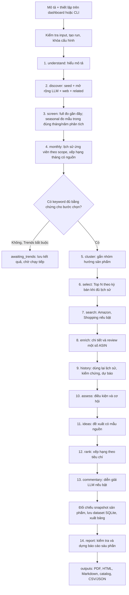
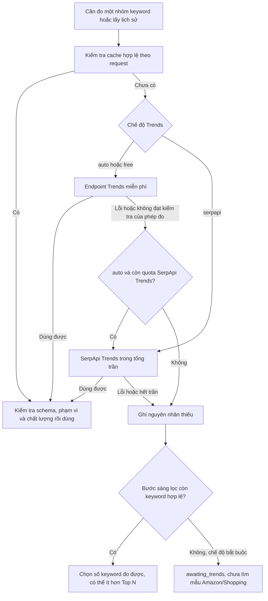

# Hướng dẫn chi tiết dự án Market Research v2

## Công cụ lấy sản phẩm trực tiếp và dashboard mới (03/11/2026)

Dashboard mặc định chọn **Công cụ trực tiếp — không dùng API sản phẩm**. Chọn nguồn Amazon, Etsy, Reddit; đặt trần HTTP, số mẫu tối đa mỗi nguồn/keyword (mặc định 20) và số trang chi tiết. API OpenRouter/Tavily/Exa/Google Trends tiếp tục phục vụ hiểu yêu cầu, khám phá keyword/chủ đề và đo trend. Muốn thêm API sản phẩm phải chọn rõ chế độ kết hợp hoặc API; chế độ trực tiếp không gọi SerpApi để tìm mẫu/chi tiết, dù tài khoản đã có key.

Phạm vi công ty và **Mục tiêu khám phá** vẫn được áp dụng: hình/nhân vật/họa tiết/câu chữ; kiểu dáng/chất liệu/phôi; hoặc suy ra từ yêu cầu. Công cụ nhận nguyên keyword được chọn, dữ liệu được lọc khớp nội dung và domain trước khi đưa vào báo cáo. Reddit được lưu ở bảng `discussions`, không biến bài viết/upvote thành sản phẩm bán hàng, doanh số hoặc review người mua. Amazon giữ nhãn mua theo tháng nếu có; giỏ hàng Etsy là tín hiệu riêng, không phải số bán. Không tự gán sao hoặc đổi VND/EUR sang USD; giá nguồn nào giữ đúng tiền tệ nguồn đó.

Kết quả thử thật: lượt `scraper-live-check-20261103` có 9 mẫu Amazon và 9 link ảnh, không gọi API nào. Etsy bị HTTP 403, Reddit lỗi kết nối; báo cáo giữ rõ nguồn thiếu. Lượt kiểm tra này tắt Trends nên chỉ chứng minh công cụ và báo cáo hoạt động, chưa xác nhận mẫu đang hot trong tháng. Website có thể đổi cấu trúc/chặn truy cập; công cụ dừng nguồn khi bị chặn, không vượt CAPTCHA/đổi IP. Listing phù hợp đã có từ khám phá có thể được dùng lại khi lấy trực tiếp thất bại.

Cài môi trường: `python -m pip install -e .` để có requests và BeautifulSoup. `scrapers/` là các import tương thích cho công cụ Gemini; phần dùng chung nằm ở `src/market_research/scraping/`. Các script độc lập chỉ giúp thử thu thập; workflow dashboard/run.py mới có đầy đủ domain, tháng/năm, bằng chứng và báo cáo. CLI cấu hình: `product_collection: {mode: scraper, sources: [amazon, etsy, reddit], detail_limit: 2, cache_hours: 24}`, `limits.scraper_requests: 30`. Cấu hình cũ không có trường này giữ cách API để chạy tiếp tương thích.

## Kết hợp Exa, Tavily và quota/credit miễn phí (03/11/2026)

Thêm `EXA_API_KEY=...` vào `.env` ở thư mục dự án hoặc `api/.env`; không đưa key vào JSON nghiên cứu. Sau khi cập nhật code, dừng server cũ bằng Ctrl+C, chạy `python run.py` và tải lại trang. Mục nguồn web hiển thị đã có/chưa có key, không hiển thị giá trị key.

**Tự động** dùng các key đã cấu hình: Tavily tìm ban đầu, Exa bổ sung nhóm chưa có nội dung mẫu hoặc thay nguồn đang lỗi/hết trần. Có thể chọn **chỉ Exa**, **chỉ Tavily** hoặc **Tavily + Exa**. Exa mặc định tối đa 4 yêu cầu/lượt, độc lập với trần Tavily; đặt 0 để không gửi yêu cầu mới. Một yêu cầu Exa lấy tối đa 8 kết quả cùng văn bản và link ảnh, không gọi thêm dịch vụ tóm tắt hay deep research. Trang trùng được gộp, giữ bằng chứng của nguồn nội dung phong phú hơn. Cache còn hạn được dùng lại giữa các lượt; không tính thêm lượt HTTP khi đọc cache.

Khi có đủ cả hai key, giao diện nghiên cứu mới chọn sẵn **Tavily + Exa**. Chế độ này lấy kết quả từ cả hai chỉ mục trong trần cho phép, kể cả khi nguồn đầu đã có một chủ đề, để tăng độ đa dạng nhân vật/họa tiết/câu chữ. **Tự động** vẫn là chế độ tiết kiệm, chỉ bổ sung nguồn thứ hai khi còn thiếu. Cả hai chế độ đều gộp trang trùng và chỉ đưa keyword phù hợp đi đo Trends.

Nếu Amazon/Shopping không có mẫu hoặc được đặt trần 0, hệ thống có thể dùng lại trang **listing sản phẩm cụ thể** trên Etsy/eBay/Walmart đã thu được và khớp nguyên keyword được chọn, không gọi API mới. Pin Pinterest, trang kết quả/category và trang không có bằng chứng không được coi là một mẫu bán hàng. Mẫu này ghi rõ nguồn listing công khai, giữ ảnh/link, để trống giá/sao/doanh số/phản hồi chưa được thu thập. Khi SerpApi bằng 0 và Trends miễn phí vẫn trả dữ liệu, nhánh này có thể đi đến báo cáo bằng các nguồn đã có; báo cáo vẫn nêu phần bằng chứng còn thiếu.

Nút **Kết hợp quota / credit miễn phí** giảm còn 16 ứng viên, Top 5 tìm mẫu, tối đa 8 keyword đối chiếu lịch sử và 2 trang chi tiết. Nút này giữ nguyên mọi trần API, tháng/năm, mô tả và nhóm hàng, không tự chạy nghiên cứu. Trends thử miễn phí trước; SerpApi dự phòng nằm trong trần đã chọn và dùng chung quota với tìm sản phẩm. OpenRouter vẫn chỉ dùng model free. Muốn tuyệt đối không gọi SerpApi cho Trends, chọn **Chỉ miễn phí** ở nguồn Trends hoặc đặt trần SerpApi dành cho Trends bằng 0; nếu Google chặn thì phép đo sẽ báo thiếu thay vì tạo tín hiệu giả.

Exa/Tavily/SerpApi áp dụng quota và credit theo tài khoản. Ứng dụng không tự biết phần số dư là miễn phí hay trả phí, không nạp tiền/tăng trần. Kiểm tra số dư và thiết lập thanh toán tại nhà cung cấp. Exa trả chi phí thì ứng dụng lưu và hiển thị riêng; hết credit (402), key lỗi (401/403) hoặc rate limit (429) sẽ dừng nguồn trong lần khám phá đó, không thử lại liên tục. Thiếu dữ liệu vẫn giữ trạng thái chưa xác minh, không bảo đảm mọi nghiên cứu đều đủ bằng chứng trong một quota nhỏ.

CLI: dùng `discovery.web_provider` là `auto`, `combined`, `exa` hoặc `tavily`, và `limits.exa_requests` là trần riêng. Tài liệu API và credit: [Exa Search](https://exa.ai/docs/reference/search), [giá Exa](https://exa.ai/docs/admin/pricing).

## Tìm nội dung để in trên sản phẩm (02/11/2026)

Mục **Mục tiêu khám phá** mặc định chọn **Hình, nhân vật, họa tiết và câu chữ trên sản phẩm**. Chế độ này cần trả lời móc khóa hình/nhân vật gì, áo in hình hoặc câu nào, giấy gói họa tiết gì; không dùng chất liệu, phôi hay kiểu áo chung thay cho nội dung thiết kế. Có thể khảo sát nhiều nhóm hàng cùng lượt. Chọn **Kiểu dáng, cấu trúc, chất liệu và phôi sản phẩm** khi cần nghiên cứu những đặc điểm vật lý này; hoặc chọn **Suy ra từ mô tả yêu cầu**.

Luồng nội dung: tìm nguồn theo từng nhóm hàng → giữ tên/chủ đề/câu chữ có trích dẫn → tạo keyword chứa cả nội dung và sản phẩm → đo nguyên keyword trong tháng/năm phân tích → tìm mẫu Amazon/Shopping khớp nội dung → báo cáo kèm ảnh nguồn và link. Một keyword trích được không làm dừng tìm các nhóm còn thiếu. Nếu nguồn tách câu chữ và loại hàng thành hai đoạn trong cùng trích dẫn, keyword ghép được ghi rõ nguồn gốc và vẫn cần phép đo Trends riêng. Tên nhân vật/câu chữ không bị tự đổi thành keyword áo hoặc móc khóa chung. LLM đề xuất chưa có nguồn vẫn là giả thuyết; Trends thiếu tín hiệu không được gọi là hot. Ảnh listing cần kiểm tra đúng biến thể trước khi gia công.

CLI dùng `discovery.focus`: `designs`, `models` hoặc `auto` (mặc định tương thích). Báo cáo chính bổ sung bảng nội dung → keyword đã đo → tháng đủ tín hiệu → link mẫu. Lượt cũ giữ nguyên dữ liệu đã thu; **xuất lại báo cáo không tìm thêm nội dung mới**. Muốn dùng luồng mới, dừng server bằng Ctrl+C, chạy lại `python run.py`, tải lại trình duyệt rồi tạo lượt nghiên cứu mới.

Cập nhật: **30/10/2026**. Luồng mới: giới hạn domain công ty → seed + mở rộng LLM/Tavily → Trends theo mùa hoặc cả năm → xếp hạng các tháng có nguồn → chọn truy vấn phù hợp kỳ bán → Amazon/Shopping → ý tưởng có bằng chứng → báo cáo Python có ảnh nguồn. Mục tiêu ứng viên mặc định **64**, không tự tăng trần API trả phí hoặc coi tất cả đề xuất là đã kiểm chứng. Bấm từng ô để xem keyword/kết quả/log. **Chưa thêm Apify.** Xem [thu thập theo mùa và domain công ty](docs/seasonal-company-research.md), [nghiên cứu keyword theo tháng và ảnh báo cáo](docs/monthly-keyword-research.md), [hướng dẫn đa nguồn và xử lý lỗi](docs/workflow-discovery.md).

**Chọn năm/tháng ngay mục 04:** các mốc 2023–2025 và tháng 10–12 chỉ là mặc định. Có thể nhập khoảng năm liên tiếp hoặc chọn năm riêng như `2021,2023,2025`, rồi tích từng tháng muốn thu. Cho phép 2–6 năm đã hoàn tất từ 2004; cùng bộ tháng áp dụng cho từng năm trong chế độ theo mùa. Dự trù API cập nhật theo năm/tháng đang chọn.

Để đọc kiến trúc hiện tại, đi theo bốn mục sau. Nội dung đã được đối chiếu với code, không chỉ là sơ đồ dự kiến:

- [Phần 6: đường đi từ dashboard/CLI, 14 bước và từng nhánh chạy](#workflow-hien-tai).
- [Phần 10: database, raw và các file báo cáo được lưu ở đâu](#luu-tru-hien-tai).
- [Phần 13: lỗi, dừng, chạy tiếp và dựng lại báo cáo](#van-hanh-hien-tai).
- [Phần 14: từng thư mục/file chính và nơi sửa theo nhu cầu](#cau-truc-hien-tai).

## Cập nhật: kiểm chứng lịch sử, SQLite và sáu phần báo cáo

### Mở rộng từ 50 keyword và phân tích 12 tháng

Dashboard mới có ô bật xếp hạng keyword theo tháng, số keyword lấy lịch sử và số dòng mỗi tháng. Tập ứng viên mặc định 64; LLM thử tối đa hai vòng bổ sung loại hàng khác nhau nếu còn thiếu, đánh dấu giả thuyết và giữ lý do phù hợp niche. Báo cáo tách ứng viên khám phá, keyword đã đo và Top N tìm mẫu, không điền từ trùng để đủ số lượng.

Preset phụ thuộc phạm vi đang chọn. Với **cả năm**, preset rộng giữ 64 ứng viên/Top 10/lịch sử 64, tổng SerpApi **50**, Trends **34**, dự trù **47** lượt khi miễn phí lỗi. Với **Q4 ba năm 2023–2025**, preset tiết kiệm có 64 ứng viên nhưng chỉ lịch sử 10/Top 5, dự trù **17** lượt trong tổng **20**/Trends **11**; preset rộng lấy lịch sử 64/Top 10, dự trù **63** lượt trong tổng **70**/Trends **54**. Các trần chỉ đổi khi bấm preset, không tự cộng quota vào tài khoản. Số năm hoặc nhóm tháng khác sẽ đổi dự trù; cache, retry và chất lượng nguồn ảnh hưởng số gọi thực tế. Xem bảng cấu hình tại [hướng dẫn mùa và domain](docs/seasonal-company-research.md).

File cấu hình CLI cũ không có `trends.monthly_rankings` giữ nhánh tháng tắt để tương thích. Dashboard mới chọn sẵn và gửi rõ `true`; muốn dùng CLI thì khai báo trường này. Chi tiết thiết lập, ý nghĩa từng hạng, các bảng xuất và giới hạn tại [docs/monthly-keyword-research.md](docs/monthly-keyword-research.md).

1. Dừng server cũ bằng **Ctrl+C**, chạy `python run.py`, rồi **Ctrl+F5** trình duyệt.
2. Trong **Thiết lập nghiên cứu**, chọn năm lịch sử bắt đầu/kết thúc (ví dụ **2021–2025**) và năm dự báo **2026**. Chọn phạm vi nguồn **cả năm** hoặc **chỉ các tháng đã chọn**. Muốn Q4 thì chọn `10,11,12`; chương trình gọi đúng Q4 từng năm, bỏ sàng lọc 90 ngày/Related ngoài phạm vi và chỉ kiểm chứng trong Q4. Các khoảng tháng so sánh là phần tổng hợp báo cáo, không tự mở rộng nguồn trong chế độ mùa. Có nút điền nhanh năm 2021–2025. Không cần sửa code.
3. Chạy nghiên cứu mới để lấy thêm năm chưa từng thu thập. **Xuất lại báo cáo** chỉ dùng quan sát đã lưu, không thể tạo dữ liệu 2021/2022 từ run chỉ có 2023–2025.
4. Đọc **Kiểm chứng và dự báo**: MAE là sai số điểm Trends; WAPE là tỷ lệ tổng sai số tuyệt đối so với tổng thực tế; so thêm mốc cùng tháng năm trước. Mức bằng chứng dựa trên số năm kiểm chứng/độ phủ/sai số, không phải xác suất bán thành công.
5. Báo cáo chính có sáu phần theo thứ tự mục tiêu → keyword/xu hướng → kiểm chứng/dự báo → sản phẩm/bằng chứng → đề xuất → ưu tiên. Bảng dài và nguồn đầy đủ nằm ở `report-details`/catalog; PDF giữ link sản phẩm và phản hồi.
6. Backend lưu chính trong **`data/market_research.sqlite3`**. `data/runs/` còn giữ raw và bản xuất phục vụ kiểm tra/phục hồi; `outputs/` chứa kết quả dựng từ database. Server tự nhập dữ liệu cũ còn thiếu; có thể chạy riêng `python run.py migrate-db`. Không xóa `data/runs` hoặc database khi cần giữ lịch sử.

Lịch sử **loại hàng/keyword** có thể lấy hồi cứu bằng Trends. Lịch sử **đúng ASIN/mẫu hàng** chỉ gồm các snapshot đã thu ở thời điểm thật; thiếu giá hoặc nhãn mua các năm trước thì báo thiếu, không điền từ dữ liệu hiện tại. Xem [cách đọc kiểm chứng](docs/history-validation.md), [cấu trúc SQLite](docs/database.md), [báo cáo sáu phần](docs/report-format.md).

### Phạm vi sản phẩm công ty

Live mới mặc định dùng hồ sơ **gia công / thiết kế / in ấn**: áo/quần có thể in/thêu, túi tote và đồ vải, lịch/sách/sổ/giấy in, móc khóa, phụ kiện điện thoại không cấp điện, decor và phụ kiện quà đơn giản. Chọn các nhóm công ty muốn nghiên cứu trên dashboard. Thực phẩm, mỹ phẩm, thiết bị y tế, máy móc và thiết bị điện/điện tử phức tạp bị loại ở keyword và mẫu hàng trước khi đưa vào idea; lý do loại được lưu. Túi đựng mỹ phẩm, cốc cà phê hoặc áo in hình món ăn vẫn có thể phù hợp vì đó là loại hàng khác. Hồ sơ nghiên cứu không xác nhận xưởng sản xuất được mọi thiết kế cụ thể.

Offline giữ hồ sơ chung để phát lại đúng dữ liệu demo. Run đã khóa thiếu `business` giữ hành vi cũ; không tự đổi ngành hàng khi resume. Có thể chủ động chọn `general` nếu cần nghiên cứu ngoài domain công ty. Trường `business.categories` giới hạn những nhóm đã chọn, không thay cho điều kiện giá, vật liệu và thời gian chuẩn bị. Xem [toàn bộ nhóm và YAML mẫu](docs/seasonal-company-research.md).

## 1. Trả lời nhanh các câu hỏi chính

| Câu hỏi | Cách hoạt động hiện tại |
|---|---|
| Đã cải tiến gì? | Thêm đầu vào mô tả tự nhiên, hiểu chủ đề/niche/điều kiện, mở rộng keyword, nhóm hướng sản phẩm, tìm mẫu từ Amazon và Shopping, phân tích, xếp hạng và dựng báo cáo Python. |
| Có cần nhập keyword trước không? | Không, khi dùng mô tả tự nhiên và bật LLM. Bạn vẫn có thể tự khai báo niche/seed nếu muốn kiểm soát phạm vi hoặc tắt LLM. |
| Chạy hết bằng một câu lệnh được không? | Có: `python run.py run --brief "Mô tả nghiên cứu"`. Sau lần cài đặt/cấu hình key, lệnh này tự chạy từ đầu vào đến báo cáo. |
| Có thể chỉ sửa input trong file không? | Có. Sửa `brief` và các điều kiện trong file YAML/JSON, rồi chạy `python run.py run --config configs/my-research.yaml`. Không cần sửa Python. |
| Có giao diện không? | Có. Chạy `python run.py serve`, mở trình duyệt, nhập mô tả và bấm **Bắt đầu nghiên cứu**. |
| Dùng dữ liệu cũ hay mới? | `live`: gọi nguồn qua API cho lượt nghiên cứu. `offline`: phát lại dữ liệu Q4 cũ. `resume`: dùng lại phần đã lưu và thử phần thiếu theo checkpoint. `report`: chỉ dựng lại từ dữ liệu đã lưu. |
| Báo cáo có bắt buộc do LLM viết không? | Không. Python dựng báo cáo chính, bảng, biểu đồ, catalog và idea theo quy tắc. LLM hiểu mô tả, mở rộng/gom keyword và trích từ trang nguồn; diễn giải bổ sung là tùy chọn. |
| Có tự chạy hằng ngày không? | Chưa có scheduler. Hiện tại tự động hóa **trong một lượt chạy**, được khởi động bằng lệnh hoặc nút bấm. |

## 2. Bản v2 khác bản cũ ở đâu?

| Thành phần | Bản trước | Bản v2 hiện tại |
|---|---|---|
| Điểm bắt đầu | Danh mục, niche và nhóm keyword khai báo sẵn | Mô tả nhu cầu bằng tiếng Việt; có thể khai báo thêm điều kiện |
| Phạm vi nghiên cứu | Kiểm chứng các nhóm đã chọn | AI đề xuất phạm vi/seed nếu chưa có; mở rộng keyword từ Related Queries khi nguồn trả dữ liệu |
| Đơn vị phân tích | Family/keyword và ASIN | Niche → hướng sản phẩm → keyword hỗ trợ → mẫu/listing/offer |
| Mẫu hàng | Chủ yếu Amazon | Amazon và Google Shopping; web bổ sung qua Tavily |
| Lịch sử | Trọng tâm mùa vụ các tháng đã chọn | Chọn năm trên dashboard, ví dụ 2021–2025; so cùng kỳ, rolling backtest và dự báo năm mục tiêu |
| Báo cáo | Bảng theo tháng, phần LLM ghép thêm | Báo cáo Python theo niche, idea, nhiều bảng ranking, catalog, CSV/JSON và nguồn |
| Xử lý lỗi | Luồng cũ gắn nhiều công việc với nhau | Checkpoint từng bước, lỗi riêng theo nguồn/hướng, trần request, chạy tiếp và nhật ký |
| Tổ chức code | `market_analysis/`, `market_radar/` | Một package `src/market_research/`, chia các thư mục theo trách nhiệm |

Các thư mục code cũ và repo clone `market-research-crew/` đã được xóa. Code mới không cần CrewAI. Bộ nguồn `data/seasonal-gifts-us/` vẫn còn vì được dùng cho demo offline: chỉ giữ dataset sản phẩm/review, chỉ mục Trends và raw được tham chiếu; báo cáo/CSV/dashboard/LLM cũ trong đó đã được dọn. Xem [ghi chú bộ nguồn](data/seasonal-gifts-us/README.md).

## 3. Ba cách sử dụng thường ngày

### Cách A — nhập mô tả và chạy hết bằng một lệnh

Sau khi đã có Python và API key:

```powershell
python run.py run --brief "Tôi muốn tìm phụ kiện sắp xếp bàn học cho người làm việc tại nhà ở Mỹ, giá bán 10–35 USD, bán quanh năm. Gợi ý ba niche và các mẫu sản phẩm có nguồn."
```

Lệnh này chạy **live** theo mặc định. Bạn không phải tự gọi từng bước lấy Trends, tìm Amazon hay xuất báo cáo.

Chương trình sẽ in tiến trình và đường dẫn cuối, ví dụ:

```text
Hiểu mô tả
Khám phá từ khóa
Gom hướng sản phẩm
Tìm mẫu Amazon / Shopping
...
Dựng và kiểm tra báo cáo
partial: C:\...\outputs\run-...\report.html
```

Tên `run-...` được tạo tự động. Mỗi lệnh nghiên cứu mới thường tạo một thư mục riêng; không ghi đè báo cáo cũ.

**`partial` vẫn có thể có báo cáo.** Nó cho biết có nguồn/khâu thiếu hoặc chưa đủ cấu trúc yêu cầu; cần đọc cảnh báo, không mặc định là lỗi toàn bộ.

### Cách B — chỉ sửa input trong một file rồi chạy một lệnh

Tạo file của bạn từ mẫu, chỉ cần thực hiện khi chưa có file riêng:

```powershell
Copy-Item configs/research.example.yaml configs/my-research.yaml
```

Mở `configs/my-research.yaml`. Ví dụ nội dung có thể dùng:

```yaml
mode: live
brief: >-
  Tôi muốn nghiên cứu phụ kiện bàn học cho người làm việc tại nhà ở Mỹ.
  Gợi ý ba niche, tìm mẫu Amazon và Shopping, phân tích giá và phản hồi.
  Ưu tiên gọn, dễ sắp xếp, bán quanh năm. Chưa có giá vốn.
market: US
history_years: [2023, 2024, 2025]
target_year: 2026
selling_months: [1, 2, 3, 4, 5, 6, 7, 8, 9, 10, 11, 12]
price_range: [10, 35]
llm:
  enabled: true
  commentary: false
sources:
  trends: true
  amazon: true
  shopping: true
  web: true
limits:
  serpapi_requests: 20
  tavily_requests: 3
  llm_requests: 8
  directions_per_niche: 4
  enrich_per_niche: 4
```

Kiểm tra cấu hình, không gọi nguồn:

```powershell
python run.py validate-config --config configs/my-research.yaml
```

Chạy toàn bộ workflow:

```powershell
python run.py run --config configs/my-research.yaml
```

Lần nghiên cứu tiếp theo, bạn chỉ sửa mô tả, tháng, giá hoặc giới hạn trong file và chạy lại lệnh `run --config`. **Không cần sửa code để đổi từ quà Noel sang đồ bàn học, làm vườn hoặc nhóm sản phẩm khác trong thị trường US.**

Khi một trường được khai báo rõ trong file, giá trị đó được ưu tiên so với phần AI suy ra từ mô tả. Vì vậy cần cập nhật cả `selling_months`/`price_range` nếu đổi chúng trong câu mô tả.

### Cách C — dùng giao diện

Giao diện mới có điều hướng, chọn ngân sách ba API, dừng/chạy tiếp, thư viện sản phẩm có lọc/sắp xếp/xuất CSV và biên tập báo cáo. Chi tiết: [docs/workspace-ui.md](docs/workspace-ui.md).

```powershell
python run.py
```

Không truyền lệnh sẽ mặc định chạy `serve`. Mở **http://127.0.0.1:8765**. Nếu cổng bận:

```powershell
python run.py serve --port 8766
```

Hoặc chạy `run.bat` / `run.bat --port 8766`.

1. Nhập mô tả vào ô **Mô tả nghiên cứu**.
2. Nếu cần, mở **Thiết lập nghiên cứu** để nhập tháng bán, ngày chốt, giá, số ngày chuẩn bị và trần SerpApi.
3. Bấm **Bắt đầu nghiên cứu**.
4. Theo dõi các bước chạy. Không phải chọn keyword/ASIN giữa chừng.
5. Mở báo cáo, catalog hoặc tải bảng dữ liệu ở phần kết quả.

`python run.py`/`serve`/`run.bat` chỉ khởi động ứng dụng, **chưa thu thập dữ liệu ngay**. Workflow bắt đầu khi bạn bấm nút. Muốn chạy hết mà không mở giao diện, dùng cách A hoặc B.

Trần SerpApi mặc định lấy từ `DEFAULT_LIMITS["serpapi_requests"]` trong `src/market_research/config.py`, hiện là **20 lượt/run**. Giao diện tải giá trị này từ server; muốn đổi mặc định chỉ cần sửa ở đó, khởi động lại server và Ctrl+F5. Muốn đổi riêng một lượt, sửa ô **Trần lượt SerpApi** trước khi bấm bắt đầu. File JSON/YAML có `limits.serpapi_requests` sẽ ghi đè mặc định khi chạy với `--config`. Trần tính cả retry và không đồng bộ quota còn lại của tài khoản. Resume giữ trần đã khóa của run cũ; mặc định mới áp dụng cho run mới.

## 4. Cài đặt ban đầu và API key

### 4.1. Môi trường

Cần **Python 3.10 trở lên**. Tại máy hiện tại, dự án đã được chạy bằng Python Anaconda. `venv/` hiện được giữ để có thể dùng lại môi trường Python; lệnh `python run.py` dùng Python đang được chọn trong terminal.

Bạn có thể dùng Python đang có. Demo JSON và server dùng thư viện chuẩn; đọc cấu hình YAML cần PyYAML.

Nếu muốn môi trường riêng cho dự án:

```powershell
python -m venv .venv
.\.venv\Scripts\python.exe -m pip install -e .
```

Khi dùng môi trường riêng, thay `python` ở các lệnh bằng `.\.venv\Scripts\python.exe`. Ví dụ:

```powershell
.\.venv\Scripts\python.exe run.py serve
```

### 4.2. Key dùng cho phần nào?

| Biến | Công dụng |
|---|---|
| `SERPAPI_API_KEY` | Amazon/Shopping; Trends khi chọn SerpApi hoặc auto cần dự phòng, trong trần đã chọn |
| `TAVILY_API_KEY` | Ngữ cảnh web nếu `sources.web: true` |
| `OPENROUTER_API_KEY` | Hiểu mô tả, mở rộng/gom keyword, trích keyword từ web; commentary nếu bật thêm |
| `OPENROUTER_MODEL` | Model LLM; ví dụ `openrouter/free` |

**Nếu đã có `api/.env` chứa key, có thể tiếp tục dùng file đó. Không bắt buộc tạo thêm `.env` gốc.**

Khi cài trên máy mới và chưa có file key, có thể tạo mẫu:

```powershell
Copy-Item .env.example .env
```

Sau đó điền key thực vào `.env`; không điền key vào file cấu hình nghiên cứu.

Thứ tự ưu tiên hiện tại là **biến môi trường → `.env` gốc → `api/.env`**. Nếu tạo `.env` gốc rồi để các key trống, các giá trị trống đó có thể che key đang có trong `api/.env`. Chỉ dùng một vị trí cấu hình chính hoặc điền các giá trị tương ứng đầy đủ.

Live không bắt buộc mọi nguồn luôn hoạt động: thiếu nguồn bổ sung có thể tạo báo cáo partial. Nhưng mô tả tự do cần LLM để hiểu/dịch phạm vi; nếu không có LLM, dùng chế độ structured ở phần 8.

## 5. Dùng dữ liệu cũ hay mới? Cách phân biệt chính xác

| Thao tác | Dữ liệu được dùng | Có thể gọi API không? |
|---|---|---|
| `run --brief ...` mặc định | Nghiên cứu live mới; Trends lấy khoảng năm đã cấu hình, mặc định 2023–2025 | Có |
| `run --config ...` với `mode: live` | Gọi nguồn theo mô tả/cấu hình, không đọc seed Q4 cũ để thay cho mô tả | Có |
| `run --config ...` với `mode: offline` | Bộ Q4 đã lưu tại `data/seasonal-gifts-us/` | Không |
| Nút **Chạy demo Q4** | Bộ Q4 đã lưu, không phải tìm kiếm mới từ ô mô tả | Không |
| `resume --run-id ...` | Giữ checkpoint/raw thành công; bước thiếu có thể cần lấy nguồn | Có, nếu có phần cần gọi và còn ngân sách |
| `report --run-id ...` | Phân tích lại dataset/evidence đã lưu, dựng lại báo cáo và bảng | Không gọi API nghiên cứu; có thể tải ảnh nguồn chưa cache |
| Mở HTML trong `examples/reports/` | Báo cáo mẫu tĩnh đã được tạo trước | Không |
| Mở nghiên cứu đã lưu trên giao diện | Các file kết quả của run đó | Không, trừ khi bạn chủ động bấm chạy tiếp |

### 5.1. Live có lấy toàn bộ từ dữ liệu cũ không?

Không. Với một run live mới, code gọi các nguồn theo phạm vi vừa lập. Dữ liệu Q4 cũ chỉ được đọc trong nhánh offline.

Trong cùng một run, phản hồi thành công được lưu làm cache; resume giữ ngày truy cập gốc. Trends miễn phí và Tavily còn có cache chung 24 giờ theo đúng tham số trong `data/cache/`, chép raw và giữ ngày lấy gốc vào run mới. SerpApi/OpenRouter vẫn chỉ cache theo run. Có thể tắt cache chung bằng `trends.cache_hours: 0`.

“Gọi API mới” nghĩa là thực hiện yêu cầu tới nhà cung cấp. Nhà cung cấp có thể có cache riêng; không thể mặc định mọi dữ liệu là quan sát trực tiếp ở đúng giây bạn bấm chạy.

### 5.2. Vì sao live vẫn có dữ liệu các năm trước?

Đó là **lịch sử tìm kiếm được yêu cầu từ Google Trends trong lượt nghiên cứu**, không phải tự gán giá hay doanh số Amazon hiện tại vào các năm cũ.

- Trends: chuỗi quan tâm từ đầu năm lịch sử đến ngày chốt.
- Amazon/Shopping: mẫu hàng, giá, nhãn mua và thông tin nguồn ở ngày thu thập.
- `as_of_date`: mốc phân tích.
- `retrieved_at`/`observed_at`: thời điểm dữ liệu được truy cập/quan sát; giữ riêng.

Chỉ đổi `as_of_date` về quá khứ không làm Amazon/Shopping trở thành snapshot quá khứ. Forecast hiện tại không được hiểu là mô phỏng hiệu quả kinh doanh trong năm cũ.

### 5.3. Chạy demo an toàn, không dùng API

```powershell
python run.py run --config examples/offline-q4.json
```

Các biến thể có sẵn:

```powershell
python run.py run --config examples/offline-budget.json
python run.py run --config examples/offline-november.json
```

Các biến thể này chỉ đổi điều kiện đối chiếu bộ nguồn đã lưu. Đổi mô tả offline thành một ngành hàng khác sẽ không làm hệ thống có dữ liệu mới cho ngành đó. Muốn nghiên cứu chủ đề mới, chọn **live**.

Bộ offline không có phản hồi Shopping/Related Queries đã lưu nên được ghi rõ thiếu nguồn. Không tạo dữ liệu giả để lấp chỗ trống.

<a id="workflow-hien-tai"></a>

## 6. Luồng tự động thực hiện những gì?

### 6.1. Điểm vào và cách chương trình điều phối

Dự án có **một pipeline nghiên cứu** tại `src/market_research/pipeline.py`. Dashboard và terminal đưa dữ liệu vào cùng pipeline đó:

```text
Terminal: run.py → cli.main() → pipeline.execute()

Dashboard: ui/assets/app.js → POST /api/runs
           → ui/server.py: Manager.submit()
           → một worker nền → pipeline.execute()

Chạy tiếp: resume → pipeline.execute(run_id=..., config=None)
Xuất lại: report → pipeline.rebuild(run_id=...)
```

`config.py` kiểm tra input; `storage/Run` tạo hoặc mở run và lưu input đã khóa. Sau đó `providers/Client` quản lý request/cache/ngân sách, còn `pipeline.py` gọi lần lượt các bước. Dashboard đọc trạng thái từ backend để cập nhật các ô tiến trình; frontend không trực tiếp gọi SerpApi, Tavily hay OpenRouter.

Các “nhánh” bên dưới là nhánh logic trong một ứng dụng Python, chưa phải nhiều service hay nhiều agent độc lập. Server dùng một worker nghiên cứu tại một thời điểm; request nghiên cứu có trần chung. Riêng tải ảnh báo cáo dùng tối đa bốn tác vụ đồng thời để tránh chờ từng ảnh. Không cần chạy riêng từng thư mục và không cần CrewAI/n8n.

### 6.2. Sơ đồ luồng live mặc định



Cửa chờ Trends áp dụng cho live có `discovery.enabled: true`, `sources.trends: true`, `trends.required: true` như mặc định. Offline hoặc cấu hình chủ động tắt cơ chế này có đường đi khác, nêu tại 6.4. `monthly` chỉ gọi lịch sử ứng viên khi bật; lịch sử ở bước 9 dùng lại checkpoint phù hợp, bổ sung phần còn thiếu và vẫn giữ mẫu hàng khi một hướng thiếu chuỗi.

### 6.3. Đúng 14 bước trong code

Mã bước dưới đây cũng là tên checkpoint và tên dùng khi tra log. Mỗi checkpoint được lưu vào SQLite, đồng thời xuất JSON trong `data/runs/<run_id>/checkpoints/`.

| Thứ tự / mã bước | File và hàm chính | Input → kết quả | Nguồn có thể gọi |
|---|---|---|---|
| 1. `understand` | `workflow/understand.py`: `interpret()` | Brief/thiết lập → category, niche, seed tiếng Anh, khách hàng giả thuyết, kỳ bán/điều kiện; thêm checkpoint `normalized_config` | OpenRouter khi cần hiểu mô tả tự do |
| 2. `discover` | `workflow/broad.py`: `discover()`; `keyword_expansion.py`; `web_discovery.py` | Seed → ứng viên, giả thuyết bổ sung, trang/câu nguồn, danh sách loại và độ phủ | OpenRouter mở rộng/trích keyword; Tavily; Trends Related nếu bật |
| 3. `screen` | `workflow/screen.py`: `analyze()` | Full: phép đo gần đây; seasonal: đo nguyên keyword mẫu trong tháng/năm phân tích, có thể chỉ một kỳ quan sát | Trends miễn phí hoặc SerpApi trong trần |
| 4. `monthly` | `workflow/monthly_keywords.py`: `analyze()`; `analysis/keyword_monthly.py` | Tập ứng viên + lịch sử theo scope → hạng các tháng có nguồn, độ phủ và nhóm so sánh; tháng ngoài scope không thu/xếp hạng | Trends trong trần; tắt/offline thì skipped |
| 5. `cluster` | `workflow/discover.py`: `cluster()` | Keyword có ID → nhóm/hướng sản phẩm và keyword hỗ trợ | OpenRouter nếu bật; có nhóm theo seed dự phòng |
| 6. `select` | `analysis/monthly_priority.py`; `workflow/selection.py` | Ưu tiên kỳ bán khi đủ lịch sử → Top N truy vấn duy nhất, lý do chọn/loại; dự phòng gần đây có nhãn riêng | Không gọi API |
| 7. `search` | `workflow/products.py`: `collect()` | Truy vấn đã chọn → các lần thấy listing, sản phẩm đã chuẩn hóa, offer, nguồn thiếu | SerpApi Amazon; Google Shopping nếu bật |
| 8. `enrich` | `workflow/products.py`: `enrich()` | Mẫu có ASIN → chi tiết, thuộc tính, giá, nhãn mua và review khi nguồn trả | SerpApi `amazon_product`, trong trần chi tiết |
| 9. `history` | `workflow/history.py`: `analyze()`; `forecasting/` | Dùng lại chuỗi ứng viên phù hợp → cùng kỳ, độ ổn định, backtest, forecast | Chỉ gọi Trends cho phần còn thiếu trong trần |
| 10. `assess` | `analysis/opportunities.py`: `assess()` | Mẫu/điều kiện/lịch sử → product checks và đánh giá từng hướng | Không gọi API |
| 11. `ideas` | `workflow/ideas.py`: `generate()` | Hướng có mẫu → idea, người nhận, mẫu chính/thay thế, mức bằng chứng và việc cần thử | Không gọi API; Python theo quy tắc |
| 12. `rank` | `ranking/engine.py`: `build()` | Các bằng chứng/đánh giá → nhiều bảng ranking có phạm vi và đồng hạng | Không gọi API |
| 13. `commentary` | `workflow/commentary.py`: `generate()` | Một số bằng chứng → diễn giải bổ sung có kiểm tra nguồn; mặc định tắt | OpenRouter nếu bật |
| 14. `report` | `reporting/render.py`: `export()` | Dataset/evidence → báo cáo chính, bảng tháng đầy đủ, catalog, ảnh và trạng thái PDF | Không gọi API nghiên cứu; có thể tải ảnh HTTPS từ nguồn |

Giữa bước 13 và 14, `analysis/product_history.py` nối các snapshot đúng danh tính sản phẩm đã lưu trong database. `Run.save_dataset()` lưu dataset và các bảng SQLite, gồm lịch sử của keyword chưa được chọn tìm mẫu; `pipeline.export_tables()` xuất bảng CSV/JSON. Đây là xử lý nội bộ, không tạo thêm lượt gọi nhà cung cấp.

### 6.4. Nhánh hiểu input và nhánh demo

| Trường hợp | Đường chạy thực tế |
|---|---|
| Mô tả tự do, chưa có niche/seed | LLM trả kế hoạch có cấu trúc; code kiểm tra và giữ các điều kiện người dùng đã nhập rõ. Không hiểu được sau các thử lại hợp lệ thì bước `understand` lỗi, không dùng nguyên câu tiếng Việt làm truy vấn Amazon. |
| Đã nhập niche và seed tiếng Anh đầy đủ | Bỏ gọi LLM ở bước hiểu input. Muốn tắt LLM ở cả các bước sau, đặt `llm.enabled: false`. |
| `mode: offline` / nút demo Q4 | Đọc `examples/archive-plan.json` và bộ `data/seasonal-gifts-us/`; bỏ sàng lọc live, không gọi nguồn nghiên cứu mới, dùng mẫu/review/Trends đã lưu. Không đổi bộ Q4 thành ngành hàng khác chỉ bằng brief. |
| `discovery.enabled: false` | Dùng nhánh khám phá theo seed trong `workflow/discover.py`; không chạy broad screening. Chọn hướng luân phiên niche theo trần truy vấn, ghi rõ chưa phải Top hot Trends. Live vẫn có thể gọi nguồn theo các cờ đã bật. |
| Chủ động tắt `sources.trends` hoặc `trends.required` | Không áp cửa chờ bắt buộc như mặc định; keyword chưa đo phải được ghi chưa xác minh. Không được hiểu danh sách này là xếp hạng hot đã có bằng chứng. |

LLM dùng chung cơ chế tại `llm/client.py`: kiểm metadata để tránh model giọng nói/embedding hoặc bắt buộc reasoning → tối đa hai lựa chọn model (ưu tiên nguồn khác nhau khi dự phòng) → một lượt khôi phục cuối nếu cần. Lượt cuối sửa JSON bằng model đã trả được nội dung, hoặc thử vendor thứ ba tương thích khi hai nguồn đầu bị 429; không gửi lượt thứ tư. Không retry tức thì cùng model OpenRouter khi nhận 429. Tham số tắt reasoning được gửi khi model hỗ trợ; không chỉ giấu phần reasoning rồi để nó dùng hết token. Tất cả request/retry vẫn trong trần OpenRouter. Metadata model công khai được cache sáu giờ trong `data/cache/openrouter-models.json`, không phải một lượt completion.

`llm/plan.py` kiểm cả category, niche, seed tiếng Anh, tháng, giá và các điều kiện trước khi chấp nhận kế hoạch; dữ liệu người dùng nhập rõ được ưu tiên. JSON đúng cú pháp nhưng sai dữ liệu cũng đi qua nhánh sửa hữu hạn. Phản hồi rỗng/cắt do token/sai JSON/sai schema được phân biệt trong log, đánh dấu cache không dùng lại và giữ bản raw lỗi riêng. Chạy tiếp không được tua lại mãi cùng phản hồi rỗng.

Nếu nhóm keyword lỗi thì gom theo seed; nếu trích web lỗi thì giữ trang nguồn nhưng không bịa keyword; nếu commentary lỗi thì báo cáo Python vẫn tiếp tục. Bước hiểu input chưa có phạm vi/seed hợp lệ thì dừng trước nguồn thị trường: sửa input khi input sai, hoặc xử lý nguồn/quota rồi chạy tiếp nếu lỗi nhà cung cấp. Không tự nhét một bộ quà tặng cố định để coi như đã hiểu mọi brief. Xem [lỗi LLM và cách khôi phục](docs/llm-startup-recovery.md).

### 6.5. Nhánh khám phá ngoài Amazon

Tập ứng viên mặc định là **64**. Sau seed ban đầu, `workflow/keyword_expansion.py` bổ sung tối đa hai vòng LLM khi mục tiêu từ 50 trở lên và còn thiếu. Đề xuất phải có niche được cấp, cụm loại hàng tiếng Anh và lý do phù hợp; biến thể gần giống bị loại. Keyword LLM chưa có nguồn được đánh dấu `hypothesis`, khác keyword quan sát được trong web/Related. Bước này đi trước trích web để mục tiêu khám phá không bị hết ngân sách bởi các lần trích lỗi; nguồn web vẫn được ưu tiên trong tập kết quả cuối. Có ít hơn mục tiêu thì ghi số thật và cảnh báo, không tự điền.

`workflow/web_discovery.py` chia các trang công khai thành ba nhóm tìm bằng Tavily:

| Nhánh | Nền tảng được chọn | Lấy gì / xử lý tiếp |
|---|---|---|
| `social` | TikTok, Facebook | URL, tiêu đề và đoạn nội dung công khai được tìm thấy; dùng bổ sung ý tưởng/ngữ cảnh |
| `marketplaces` | Etsy, Walmart, eBay | Trang công khai liên quan loại sản phẩm và câu nguồn để tìm keyword mới |
| `visual` | Pinterest | Trang ý tưởng/ngữ cảnh sản phẩm đã được lập chỉ mục |

Các nhóm dùng chung trần `tavily_requests`; không tự có quota riêng cho từng nền tảng. Trang chủ chung, recall/chính sách, nội dung yếu/ngoài phạm vi hoặc đăng sau ngày chốt được lọc. LLM chỉ được nhận keyword có trong câu trích của trang đã lưu. Nếu chưa có keyword mới và còn lượt Tavily, code thử tối đa ba truy vấn ngắn theo niche, vẫn trong tổng trần.

Nhánh Related dùng `providers/trends.py`, lấy top/rising khi nguồn trả được. Broad discovery hiện thử tối đa **hai seed toàn lượt**; trần Related SerpApi mặc định 0 để giữ lượt cho đo Trends và mẫu hàng. Nhánh này lỗi vẫn giữ seed/web ứng viên cho bước sàng lọc.

Không có Apify hoặc kết nối trực tiếp TikTok Shop/Meta trong bản này. Một link Facebook/TikTok không đồng nghĩa lấy được toàn bộ comment, số đơn hay dữ liệu tài khoản; không xác nhận người xem là khách Mỹ. Các trang web tham khảo cũng không tự thành mẫu Amazon hoặc offer Shopping.

### 6.6. Nhánh Trends: cache, miễn phí, SerpApi và trạng thái chờ



Chi tiết cần phân biệt:

- Ở chế độ **cả năm**, `screen` so tối đa bốn truy vấn cùng một anchor trong mỗi nhóm, mặc định cửa sổ 90 ngày; tính mức quan tâm 28 ngày gần nhất và tăng trưởng so 28 ngày trước. Ở chế độ **theo mùa**, sàng lọc nguyên keyword mẫu trong đúng tháng/năm phân tích; Related dùng cùng kỳ nếu có ngân sách. Một kỳ quan sát có thể so mẫu mới, còn dự báo mùa cần lịch sử riêng. Thứ hạng chỉ trong tập ứng viên. Xem [sàng lọc mẫu thiết kế theo tháng](docs/design-trends-by-month.md).
- `trend_queries.py` có thể bỏ mô tả cá nhân hóa/người nhận để đo loại hàng rộng. `measurement_query` và `measurement_scope` lưu rõ điều đó; không coi các biến thể khác nhau có cùng mức hot.
- Phép đo miễn phí thường cần hai HTTP request (`explore` rồi widget), đếm vào `free_trends_requests`; SerpApi Trends đếm vào trần SerpApi. Google 429 có cơ chế nghỉ và không lặp vô hạn. HTTP 200 có dữ liệu rỗng/sai schema vẫn không được coi là hoàn tất.
- `auto` mới được chuyển từ miễn phí sang SerpApi. Chọn `free` thì không tự dùng SerpApi; chọn `serpapi` thì gọi nhánh trả phí trực tiếp. Cache hợp lệ có thể được dùng mà không gửi request mới.
- Nếu thiếu nhóm có tín hiệu và còn ngân sách phù hợp, `screen` có thể thử toàn bộ cửa sổ 365 ngày **một lần**. Chỉ chọn bộ kết quả phục hồi nếu tốt hơn về độ phủ; không trộn chỉ số hai cửa sổ.
- Ít điểm dương/giá trị 0 có đủ dữ liệu là `low_signal`, khác lỗi mạng/thiếu dữ liệu. Nếu chỉ đo được 3/10 keyword yêu cầu, có thể tìm mẫu cho ba keyword đó. Nếu không đo được keyword nào trong chế độ bắt buộc thì chờ, không bỏ qua âm thầm.
- Lịch sử nhiều năm ở `history` dùng cùng bộ chuyển nguồn nhưng cô lập lỗi theo hướng. Một hướng thiếu lịch sử không làm mất sản phẩm đã tìm thấy; forecast giữ thiếu và báo giới hạn.

Nhánh lịch sử riêng hướng trong live/broad gom tối đa **5 truy vấn/yêu cầu** khi không dùng anchor; 10 keyword thường cần 2 lượt. Nhánh tháng của toàn tập dùng **4 keyword + anchor** để có nhóm so sánh chung, lưu checkpoint riêng từng hướng và ghi ngữ cảnh chuẩn hóa. Chỉ so năm của cùng keyword trên cùng chuỗi; không so chỉ số tuyệt đối giữa các batch. Tín hiệu thấp vẫn có thể khiến dự báo chưa đủ dữ liệu.

Ở chế độ **cả năm**, khi tắt nhánh tháng, `workflow/planning.py` giữ trước `ceil(Top keyword / 5)` lượt lịch sử trong trần Trends (tối đa cap trừ một để còn sàng lọc). Với cap 8/Top 10: sàng lọc và related dùng tối đa 6 lượt trả phí trước lịch sử, 2 lượt còn lại giữ cho lịch sử. Khi bật nhánh tháng, dự trù `ceil(monthly_keywords / 4)` lịch sử có anchor; 64 ứng viên thường cần 16 sàng lọc + 16 lịch sử.

Ở chế độ **theo mùa**, `seasonal_windows()` gom các tháng liền nhau theo từng năm. Lịch sử cần khoảng `ceil(monthly_keywords / 4) × số cửa sổ`, không có phần sàng lọc 90 ngày/Related. Với Q4 2023–2025: 10 keyword cần khoảng 9 lượt lịch sử, 64 keyword khoảng 48 lượt. Ít tháng không tự giảm lượt API vì một request cả năm vốn đã có thể chứa nhiều tháng; chỉ Q4 nhiều năm phải gọi cửa sổ riêng. Dự trù và trần đều hiện trên form. History sau tìm mẫu dùng lại chuỗi phù hợp đã lưu; cache có thể giảm số gọi mới. Không tự tăng cap hoặc đổi quota run cũ.

Phần giữ cho lịch sử cũng được bảo vệ khỏi request tìm mẫu/chi tiết trong trần tổng; có thể lấy ít mẫu/chi tiết hơn nếu ngân sách không đủ cả hai. Chọn Trends miễn phí hoặc tắt nguồn thì không giữ lượt lịch sử trả phí.

Ô xanh nghĩa là bước đã xử lý xong, không khẳng định sản phẩm chắc chắn bán được. `low_signal` có đủ dữ liệu là kết quả loại hợp lệ; không làm bước sàng lọc hoặc Top N đã chọn đủ thành lỗi. Ô vàng là thiếu phép đo/đầu ra/chỉ tiêu. Lịch sử có dự báo nhưng chưa có fold kiểm chứng vẫn là có phần thiếu. Nhận định LLM đã tắt hiện “Không áp dụng”. Nhấn ô để xem ghi chú, dữ liệu và log; `grouping_method` cho biết gom nhóm bằng LLM hay Python. Xem [rà soát run quà Giáng sinh](docs/run-audit-20261030.md) để đối chiếu ví dụ 21/30 lượt tổng nhưng hết cap Trends 8/8.

Trần Trends là **phần nằm trong trần SerpApi tổng**, không cộng thêm quota. Với mặc định hiện tại: tổng 20, Trends tối đa 8, mức dành cho mẫu hàng 10; Related trả phí 0. Request/retry thực tế của cả tìm mẫu, chi tiết và Trends đều đi qua `providers/client.py`. Các con số có thể sửa trước run; resume giữ nguyên ngân sách đã khóa.

### 6.7. Nhánh sản phẩm: search khác lấy chi tiết

1. `selection.py` chọn tối đa `top_keywords` **truy vấn duy nhất**. Nhiều ngữ cảnh niche có thể cùng dùng một truy vấn đã chọn; không bảo đảm mỗi niche có số keyword bằng nhau.
2. `products.collect()` tìm Amazon khi bật. Nếu bật Shopping, chỉ đối chiếu trong giới hạn `shopping_keywords` của luồng broad; không chia quota tự động một nửa Amazon/một nửa Shopping.
3. Mỗi phản hồi có thể chứa nhiều mẫu. `products_per_direction` giới hạn số mẫu xét từ từng phản hồi, không phải số lần gọi API. Truy vấn dài thực sự không có kết quả mới được thử rút gọn hữu hạn; lỗi key/quota không tạo vòng tìm kiếm vô hạn.
4. `analysis/products.py` kiểm liên quan, xử lý Sponsored và gộp danh tính chắc chắn như ASIN/URL; vẫn giữ các lần xuất hiện và offer. Không gộp hai mẫu chỉ vì tên/ảnh giống nhau.
5. `products.enrich()` chọn ASIN luân phiên các niche/hướng có mẫu để lấy chi tiết; các trần `product_details`, `enrich_per_niche` và SerpApi tổng cùng giới hạn bước này. Search được 20 mẫu không có nghĩa cả 20 đều có detail/review.
6. Lỗi một nguồn/hướng được ghi trong `source_status` và log, rồi xử lý hướng khác còn ngân sách. Review và trích đoạn luôn gắn `product_id`/ASIN đúng mẫu; không lấy comment của mẫu A lấp cho mẫu B.

### 6.8. Nhánh lịch sử, phân tích và xuất báo cáo

`workflow/monthly_keywords.py` ở trước gom nhóm/chọn sản phẩm, lấy lịch sử tới trần `monthly_keywords` trong tập ứng viên, kể cả hướng chưa được đưa đi tìm mẫu. `analysis/keyword_monthly.py` dựng bảng cho từng tháng từ lịch sử có thật. **Hạng phù hợp mùa** so mỗi keyword với đỉnh riêng; **hạng nhu cầu** chỉ so khi cùng thang anchor/batch, không ghép điểm Google Trends chuẩn hóa riêng thành một Top giả. `analysis/monthly_priority.py` ưu tiên kỳ bán bằng 70% phân vị tỷ lệ nhu cầu so anchor + 30% phân vị phù hợp mùa khi đủ năm cho các tháng bán trên một nhóm so sánh. Nếu phải dự phòng bằng phép đo gần đây, kết quả ghi rõ phương pháp.

`history.analyze()` chọn nhánh theo scope. **Full** lấy chuỗi liên tục từ đầu năm cần thiết đến ngày chốt; khoảng so sánh sớm hơn có thể mở rộng cửa sổ nguồn nhưng không đổi năm huấn luyện. **Seasonal** gọi `workflow/seasonal_history.py` để chỉ lấy các nhóm tháng đã chọn trong `history_years`; khoảng so sánh không tự thêm tháng/năm vào nguồn. Checkpoint lịch sử giữ riêng phạm vi để không nhầm chuỗi cả năm với chuỗi mùa; `history` chứa kết quả tổng hợp các hướng.

Trong `forecasting/`: `series.py` đổi dữ liệu nguồn sang tháng; `periods.py` tính khoảng so sánh; `assess.py` tính mùa vụ cả năm; `seasonal.py` dự báo chỉ các tháng đã thu. `validation.py` giấu năm đã biết, chỉ dùng năm trước để dự đoán và chấm sai số trong đúng phạm vi tháng. Tháng ngoài scope không có giá trị 0 hoặc forecast giả. Dữ liệu mùa được chuẩn hóa theo anchor=100, có thể vượt 100; đỉnh/CV/tăng trưởng chỉ nói về kỳ đã chọn, không khẳng định cả năm. `analysis/product_history.py` chỉ đọc snapshot đúng ASIN đã quan sát trong SQLite; năm chưa thu giá/nhãn mua thì ghi thiếu.

`assess` kiểm điều kiện giá/đặc tính và tín hiệu cơ hội. Thiếu điều kiện cứng là chờ xác minh, không tự đạt. `ideas` tạo ý tưởng gắn mẫu chính, mẫu thay thế khi có, người nhận, căn cứ thời điểm và mức bằng chứng; hướng khác biệt từ phản hồi được tách khỏi giả thuyết thiết kế cần thử. Mục tiêu 2–3 idea/niche phụ thuộc số hướng và bằng chứng, không nhân bản để đủ số. `rank` xếp riêng từng tiêu chí, giữ nhóm so sánh/đồng hạng; `commentary` chỉ bổ sung lời giải thích nếu bật.

Bước `report` kiểm tra dữ liệu, dựng phụ lục đầy đủ và báo cáo chính sáu phần, tạo PDF, catalog, `keyword-monthly.html/.md`, bản xuất dataset/nguồn/usage. HTML chính được công bố sau các file kèm theo. Ảnh nguồn được chuẩn bị tối đa bốn tác vụ đồng thời, có cache rồi nhúng PDF; kết quả/thiếu ảnh ghi trong `image-status.json`, không tạo ảnh giả. Tải ảnh từ CDN không phải một lượt API nghiên cứu. Xem [nghiên cứu theo tháng và ảnh](docs/monthly-keyword-research.md), [định dạng báo cáo](docs/report-format.md), [cách đọc kiểm chứng](docs/history-validation.md).

### 6.9. Một request được quản lý thế nào?

Tất cả API nghiên cứu đi qua `providers/client.py`, không gọi tùy ý từ từng bước:

```text
Kiểm tra yêu cầu dừng → tìm cache đúng tham số → nếu chưa có:
kiểm tra key/nguồn/ngân sách/thời gian → ghi nhận lượt trước khi gửi
→ HTTP → lưu raw đã che key và trạng thái → kiểm tra dừng
→ trả dữ liệu hoặc retry có giới hạn / báo lỗi cho bước gọi.
```

Lượt lỗi và retry cũng có thể dùng quota; cache được tái sử dụng không cộng lượt gửi mới. Thời gian chạy được kiểm tra trước request mới, không phải cam kết sẽ cắt ngang ngay một request đang chờ. Không có cơ chế cố gọi cho hết trần khi đã làm xong những nhiệm vụ được cấu hình.

### 6.10. Các nhánh thao tác trên dashboard

| Thao tác | Đường backend | Có chạy nghiên cứu/gọi API nghiên cứu không? |
|---|---|---|
| Mở form / đổi giới hạn trước khi chạy | `GET /api/settings`, sau đó frontend dựng input | Không |
| Bắt đầu nghiên cứu hoặc demo | `POST /api/runs` → `Manager.submit()` → `execute()` | Live có thể gọi; demo offline không |
| Xem lịch sử / mở một run | `GET /api/runs` hoặc `GET /api/runs/<id>` | Chỉ đọc dữ liệu và trạng thái |
| Bấm ô tiến trình để xem keyword/kết quả/log | `GET /api/runs/<id>/stages/<stage>` → `ui/progress.py` | Chỉ đọc checkpoint/log đã lọc thông tin nhạy cảm |
| Thư viện sản phẩm / lọc và sắp xếp | `GET /api/products`; CSV: `GET /api/products/export.csv` | Đọc mẫu đã có, xử lý bộ lọc/thứ tự; không tìm sản phẩm mới |
| Mở báo cáo/catalog/PDF | `GET /outputs/<id>/...` | Đọc file đã xuất; đóng báo cáo không dừng hay xóa run |
| Lưu nghiên cứu/sản phẩm | `POST /api/workspace/save` → `ui/workspace.py` | Ghi mục đã lưu trong DB, không gọi nguồn |
| Biên tập báo cáo | `GET/POST /api/runs/<id>/editor` | Lưu bản biên tập/lịch sử riêng; không sửa dataset hoặc báo cáo gốc |
| Dừng | `POST /api/runs/<id>/stop` → cờ dừng | Không gửi thêm request sau điểm kiểm tra dừng; request đang gửi có thể phải chờ xong |
| Chạy tiếp | `POST /api/runs/<id>/resume` → `execute()` | Có thể gọi phần còn thiếu trong trần cũ |
| Xuất lại báo cáo | `POST /api/runs/<id>/report` → `rebuild()` | Không gọi API nghiên cứu; có thể lấy ảnh HTTPS chưa cache |

Việc frontend cập nhật tiến trình bằng các request đọc tới server local không phải một lượt SerpApi/Tavily/OpenRouter. Đừng nhầm số request thấy trong tab Network của trình duyệt với bộ đếm quota nhà cung cấp.

## 7. Đầu vào nên viết thế nào?

Một mô tả hữu ích thường gồm: lĩnh vực, thị trường, người nhận/người dùng, nhu cầu, kỳ bán, khoảng giá và điều cần tránh. Không bắt buộc phải biết tất cả.

Ví dụ theo mùa:

> Tôi muốn nghiên cứu quà và decor lễ hội bán ở Mỹ tháng 11–12. Tập trung trang trí bàn Thanksgiving, lịch Advent và quà nhỏ bỏ tất Noel. Ưu tiên gọn nhẹ, có thể cá nhân hóa, giá bán 15–35 USD. Hãy tìm keyword liên quan, mẫu hàng và các hướng nên khảo sát. Chưa có giá vốn.

Ví dụ quanh năm:

> Tôi muốn tìm phụ kiện sắp xếp bàn làm việc tại nhà cho thị trường Mỹ. Hãy gợi ý ba niche cụ thể, tìm mẫu trên Amazon/Shopping, phân tích giá và phản hồi. Ưu tiên món nhỏ gọn, giá bán 10–35 USD, bán quanh năm.

Các mô tả này là ví dụ input, **không phải phát hiện thị trường đã kiểm chứng**.

Phân biệt ba loại điều kiện:

| Loại | Ví dụ | Xử lý |
|---|---|---|
| Phạm vi | Thị trường US, bán tháng 11–12 | Dùng để lập truy vấn và phân tích |
| Điều kiện cứng | Giá phải 15–35 USD; vật liệu bắt buộc | Mẫu không đạt bị loại; thiếu dữ liệu xác minh thì chờ kiểm tra |
| Ưu tiên mềm | Ưu tiên gọn nhẹ, thiết kế đẹp | Giữ làm ngữ cảnh; không tự đoán trọng lượng/chất lượng từ tên hoặc ảnh |

Khả năng kiểm điều kiện cứng hiện dựa trên dữ liệu listing/thuộc tính và đối chiếu từ/cụm từ. Các tiêu chí mơ hồ như “đẹp”, “cao cấp”, “dễ bán” chưa có thước đo tự động đáng tin để tự kết luận đạt.

## 8. Có thể tắt hoàn toàn LLM không?

Có, nhưng khi đó cần khai báo rõ niche/seed để code không phải tự hiểu/dịch một mô tả tự do. Ví dụ có sẵn:

```powershell
python run.py run --config examples/structured.json
```

Đây vẫn là **live**, vẫn gọi Trends/Amazon/Shopping và web theo cấu hình; chỉ không gọi LLM. Có thể sửa niche và seed trong file này cho một nghiên cứu khác.

| Cấu hình | Hiểu mô tả | Nhóm keyword | Báo cáo chính | Diễn giải bổ sung |
|---|---|---|---|---|
| `enabled: true`, `commentary: false` | LLM nếu chưa có đủ niche/seed | LLM, có fallback theo seed | Python | Tắt |
| `enabled: true`, `commentary: true` | Như trên | Như trên | Python | LLM khi có ngân sách/nguồn |
| `enabled: false`, niche/seed đầy đủ | Dùng cấu hình đã nhập | Nhóm theo seed | Python | Tắt |
| Offline Q4 | Phạm vi đã ghi của bộ mẫu | Nhóm seed lưu trữ | Python | Không gọi |

**Tắt `commentary` không có nghĩa là tắt mọi lượt LLM.** Chỉ tắt phần viết nhận định bổ sung; hiểu mô tả, mở rộng, trích từ nguồn và nhóm keyword vẫn có thể gọi model khi `enabled: true`.

Idea hiện được tạo bằng quy tắc Python gắn mẫu hàng/bằng chứng. Một số đề xuất cải thiện dựa trên câu review về hướng dẫn, đóng gói hoặc kích thước. Đây chưa phải một hệ thống sáng tạo sản phẩm hoặc hiểu ngữ nghĩa sâu mọi review. Commentary LLM bổ sung diễn giải, không tự thay hạng/số liệu hoặc thay toàn bộ idea đã tạo.

## 9. Lịch sử tự chọn và dự báo được dùng thế nào?

Mục đích là trả lời: **hướng đang được xem xét có lịch sử quan tâm tương đối ổn định không, và lịch sử đó hỗ trợ kỳ vọng 2026 đến đâu?**

### 9.1. Dữ liệu lịch sử

Trends được yêu cầu trong một cửa sổ từ đầu năm lịch sử đến ngày chốt. Code tổng hợp các khoảng nguồn sang tháng theo số ngày giao nhau; giữ tháng thiếu và tháng chưa tới riêng.

Với mặc định hiện tại:

1. Nếu không khai báo, cấu hình vẫn dùng 2023–2025. Dashboard cho chọn năm khác, gồm preset 2021–2025; hỗ trợ 2–6 năm hoàn tất trước năm dự báo.
2. Năm phải có đủ 12 tháng, đủ điểm dương và độ lớn tín hiệu theo ngưỡng code mới được dùng dự báo.
3. So trung bình 12 tháng từng năm, độ phân tán mức năm và tháng cao điểm.

Độ ổn định mùa vụ gồm CV mức trung bình năm và tương quan hình dạng 12 tháng, bên cạnh tỷ lệ năm có cùng tháng đỉnh. Nhãn ổn định cần ít nhất hai năm, CV ≤0,25 và tương quan ≥0,6. Các ngưỡng là quy tắc ứng dụng và được ghi vào dữ liệu; **không đồng nghĩa mọi tháng hoặc mọi mùa đều giống nhau**. Xem đầy đủ tại [kiểm chứng lịch sử](docs/history-validation.md).

### 9.2. Kiểm chứng và dự báo

- Kiểm chứng cuốn chiếu: sau ít nhất hai năm huấn luyện, dự đoán từng năm đã biết và so thực tế với mốc cùng kỳ năm liền trước. Với 2021–2025 có thể thử 2023, 2024 và 2025; báo MAE/RMSE/WAPE/sMAPE, độ phủ và số năm thử. Ba năm 2023–2025 chỉ có một năm thử đủ điều kiện.
- Dự báo tham khảo 2026: lấy trung vị cùng tháng của các năm lịch sử đủ điều kiện.
- Ví dụ thuần minh họa: nếu một tháng có các chỉ số lịch sử 10, 12, 11 thì trung vị bằng 11. Đây không phải số lượt tìm kiếm hay số đơn hàng.
- Quan sát 2026 được đối chiếu riêng; không đưa giá trị 2026 vào phần fit dự báo 2026.
- Nếu không đủ lịch sử, dự báo giữ `null`/thiếu; việc tìm mẫu hàng hiện tại vẫn tiếp tục.

Khoảng min–max trong bảng là độ phân tán lịch sử, không phải khoảng tin cậy xác suất. Một phép kiểm chứng trên một năm không chứng minh dự báo sẽ luôn đúng. Thời điểm cao điểm keyword cũng không chứng minh mẫu hàng cụ thể bán chạy.

<a id="luu-tru-hien-tai"></a>

## 10. Output nhận được gồm những gì?

Có database chính và hai khu vực file:

```text
data/market_research.sqlite3     # DB chính: run, checkpoint, dataset, nguồn, snapshot, log
data/runs/<run_id>/               # Raw và bản xuất để kiểm tra/khôi phục
├── manifest.json                # Bản xuất input đã khóa, trạng thái, lỗi, usage
├── normalized_config.json       # Chủ đề/niche/seed/điều kiện đã hiểu
├── raw/<provider>/              # Phản hồi nguồn, key đã được che
├── checkpoints/                 # Kết quả từng bước
├── evidence.json                # Registry bằng chứng nội bộ
├── dataset.json                 # Bản xuất dataset; backend đọc SQLite trước
└── logs/                        # Traceback riêng nếu có lỗi

outputs/<run_id>/                # Kết quả để đọc và tải
├── report.html
├── report.md
├── report.pdf                   # Sáu phần chính, link sản phẩm có thể bấm
├── report-details.html / .md    # Bảng chi tiết, phương pháp và nguồn
├── keyword-monthly.html / .md   # Toàn bộ ứng viên và bảng xếp hạng từng tháng
├── image-status.json            # Ảnh có cache/tải được hay còn thiếu, lý do
├── catalog.html
├── catalog.md
├── niches/                      # HTML/Markdown theo niche
├── tables/                      # CSV và JSON từng bảng
├── dataset.json
├── sources.json
├── validation.json
└── usage.json
```

Dữ liệu đi theo đường: **phản hồi nhà cung cấp → raw đã che key → chuẩn hóa và evidence/checkpoint → dataset + các bảng SQLite → báo cáo/bảng xuất trong outputs**. Trong giai đoạn đang chạy, checkpoint đã có trước khi có dataset cuối cùng. Khi lỗi, vẫn có thể xem keyword/log và chạy tiếp dù chưa có báo cáo.

| Nơi lưu | Vai trò / ai đọc |
|---|---|
| `data/market_research.sqlite3` | Nơi lưu chính: run/input/usage, bước/checkpoint, evidence/log, dataset và bảng keyword, mẫu/offer, review, Trends, backtest, forecast. Backend ưu tiên đọc DB. |
| `data/runs/<id>/raw/<provider>/` | Phản hồi HTTP đã che key, tham số và thời điểm lấy; dùng kiểm tra nguồn và tái sử dụng trong run. Đây vẫn là file JSON, không cần đưa ảnh/raw lớn vào SQLite. |
| `data/runs/<id>/checkpoints/`, `manifest.json`, `evidence.json`, `dataset.json` | Bản xuất tương thích/khôi phục; DB có dữ liệu thì sửa JSON không tự thay đổi trạng thái backend. |
| `data/runs/<id>/logs/` | Traceback của bước lỗi, đã che key; không công khai qua UI. `events.jsonl` là bản xuất nhật ký tiến trình, DB cũng lưu events. |
| `data/cache/` | Cache dùng chung của Trends miễn phí/Tavily và thời điểm nghỉ sau 429; phát sinh khi dùng nguồn. Giữ cache có thể tiết kiệm lượt. |
| `data/report-images/` | Ảnh sản phẩm từ nguồn đã tải để nhúng PDF và dùng lại; không phải ảnh AI tạo. |
| `data/workspace/state.json` | Bản xuất mục đã lưu/metadata biên tập nếu đã phát sinh; DB `workspace_state` là nơi đọc chính. |
| `data/seasonal-gifts-us/` | Bộ nguồn Q4 cho offline; live không lấy seed trong bộ này để thay brief mới. |
| `outputs/<id>/` | Báo cáo chính/phụ lục/catalog, ảnh `assets/`, bảng `tables/`, dữ liệu/nguồn/usage để đọc và chia sẻ. Có thể dựng lại từ dữ liệu đã lưu. |
| `outputs/<id>/revisions/` và file `report-edited.*` | Bản biên tập hoặc bản sao lưu nếu đã tạo; không phải lần thu thập mới. |

Migration tại `python run.py migrate-db` chỉ nhập phần dữ liệu cũ còn thiếu, không xóa raw hay đặt lại usage. Server cũng thực hiện kiểm tra nhập dữ liệu cũ khi khởi động. Xem [schema SQLite và sao lưu](docs/database.md), [từ điển dữ liệu](docs/data_dictionary.md).

### 10.1. Đọc báo cáo

Mở `outputs/<run_id>/report.html` trong trình duyệt. Nội dung gồm:

- Phạm vi, mô tả đầu vào, cách hiểu, giả định và ngày dữ liệu.
- Keyword/hướng sản phẩm theo từng niche.
- Tóm tắt bảng tháng và độ phủ; `keyword-monthly.html/.md` giữ danh sách ứng viên và các bảng chi tiết.
- Mẫu hàng và link, giá, nhãn mua, phạm vi rating, ngày quan sát.
- Review/chủ đề có trích đoạn nguồn khi có dữ liệu.
- Lịch sử, độ ổn định, kiểm chứng, dự báo và giới hạn.
- Idea: bán gì, cho ai, vì sao cân nhắc lúc này, mẫu đối chiếu, việc cần thử.
- Xếp hạng niche, phần tóm tắt ba idea và các ranking khác.
- Nguồn thiếu, phương pháp, usage/chi phí và giới hạn kết luận.

Mỗi niche hiển thị tối đa ba idea chính khi có đủ căn cứ; hướng bổ sung vẫn giữ ở dữ liệu/phụ lục. Không ép sinh hai–ba idea nếu nguồn không đủ. Phần ba idea tổng kết không khẳng định ba ý đó tốt nhất tuyệt đối khi còn những nhóm không thể so sánh trực tiếp.

Để lưu PDF, dùng nút **In / lưu PDF** của HTML và chọn Save as PDF trong trình duyệt. Pipeline hiện xuất file HTML/Markdown; PDF được tạo qua thao tác in này, không có lệnh CLI xuất PDF tự động.

### 10.2. Xem catalog

`catalog.html` dùng để đối chiếu mẫu hàng: tên, nguồn, giá/tiền tệ, hướng, nhãn mua, ngày và mã bằng chứng. Có ô lọc tên/ASIN/nhà bán.

Ảnh chỉ có khi nguồn trả thumbnail hợp lệ. Không phải mọi mẫu đều có ảnh hoặc review. Thứ tự hiển thị catalog không phải thứ hạng bán chạy.

### 10.3. Các bảng nên mở trước

| Bảng trong `tables/` | Dùng để xem |
|---|---|
| `keywords.csv` | Seed và keyword liên quan, nguồn gốc từng từ |
| `directions.csv` | Hướng sản phẩm, keyword đại diện và các keyword hỗ trợ |
| `products.csv` | Mẫu đã định danh, thuộc tính, giá/nhãn và ngày |
| `offers.csv` | Quan sát giá/biến thể/nhà bán; giữ dữ liệu riêng theo nguồn/ngày |
| `reviews.csv`, `review_themes.csv` | Review đầy đủ/trích đoạn và chủ đề được nhắc |
| `trend_observations.csv` | Lịch sử chỉ số theo tháng và trạng thái quan sát |
| `keyword_monthly.csv` | Keyword × tháng, hạng phù hợp mùa/hạng nhu cầu trong nhóm so sánh, điểm, năm và bằng chứng |
| `keyword_history_observations.csv` | Chuỗi tháng của tập ứng viên, kể cả keyword chưa chọn tìm sản phẩm |
| `forecasts.csv` | Dự báo tham khảo, quan sát và độ phân tán lịch sử |
| `assessments.csv`, `product_checks.csv` | Đánh giá hướng và kiểm điều kiện cứng |
| `ideas.csv` | Đề xuất, mẫu, căn cứ và bước kiểm chứng |
| `ranking_definitions.csv`, `all_ranked_items.csv` | Định nghĩa bảng và toàn bộ thứ hạng |
| `all_candidates.csv`, `search_occurrences.csv` | Các ứng viên/lần xuất hiện đã ghi trong giới hạn thu thập |
| `source_status.csv` | Nguồn nào có dữ liệu, rỗng, bị tắt hoặc lỗi |
| `keyword_exclusions.csv`, `product_matches.csv` | Từ bị loại và các quan hệ định danh đã xác nhận |

“Toàn bộ ứng viên” ở đây là toàn bộ ứng viên **đã ghi nhận trong trần của lượt chạy**, không có nghĩa đã thu thập toàn bộ thị trường. CSV chứa trường list/dict dưới dạng JSON; file JSON tương ứng dễ dùng khi viết phân tích tiếp.

`sources.json` giải mã các mã bằng chứng thành URL/đoạn nguồn/ngày. `validation.json` ghi lỗi cấu trúc và độ thiếu dữ liệu. `usage.json` ghi các lượt gọi, model/token/cost khi có và số lần đọc cache.

### 10.4. Hiểu các ranking

Có bảng riêng cho tăng trưởng keyword, mùa, cơ hội hướng, tín hiệu mua Amazon, giá tương đương, khác biệt, độ phủ bằng chứng, niche, mẫu và idea.

- Hạng chỉ có ý nghĩa trong **nhóm so sánh** của bảng đó.
- Nhãn mua Amazon là một khoảng làm tròn, không phải doanh số chính xác.
- Giá không được xếp tương đương khi thiếu quy cách/variant.
- Một số rubric có nhóm `known-abcde`: năm vị trí lần lượt biểu thị đã biết/chưa biết về mùa, cầu, mua, khác biệt và phù hợp. Không so thứ hạng giữa các nhóm có độ đầy đủ thông tin khác nhau.
- Đồng hạng được giữ. ID chỉ ổn định thứ tự hiển thị, không chứng minh ý nào tốt hơn.
- Bảng `unavailable` nghĩa là chưa đủ dữ liệu cho tiêu chí đó; không tự tạo hạng để đủ số dòng.

## 11. Thay đổi input nào là dễ nhất?

| Muốn thay đổi | Cách làm |
|---|---|
| Chủ đề/danh mục | Đổi câu `brief`; để AI lập phạm vi khi chưa nhập niche/seed |
| Giữ niche đã chọn | Khai báo `niches` trong file; code ưu tiên niche người dùng đã nêu |
| Tháng bán | Đổi `selling_months`, ví dụ `[11, 12]` |
| Giá bán tham khảo | Đổi `price_range`, ví dụ `[15, 35]` USD |
| Thời gian chuẩn bị | Điền `preparation_days`; thiếu thì không tự kết luận lead time phù hợp |
| Chạy nhiều/ít dữ liệu hơn | Đổi `limits`, vẫn theo trần tài khoản API |
| Tắt ngữ cảnh web | `sources.web: false` |
| Thêm nhận định LLM | `llm.commentary: true`, với `enabled: true` |
| Tắt LLM | `enabled: false` và cung cấp niche/seed đầy đủ |
| Thay năm nghiên cứu | Đổi `history_years`, `target_year`, `as_of_date` cho hợp lệ |
| Chỉ lấy Q4 các năm trước | `trends.history_scope: seasonal`, `history_months: [10, 11, 12]`; số cửa sổ ảnh hưởng dự trù API |
| Chọn nhóm hàng công ty | `business.profile: custom_manufacturing` và danh sách `business.categories`; có giao diện chọn nhóm |

Các năm lịch sử phải đã hoàn tất trước năm ngày chốt; năm dự báo phải sau các năm lịch sử. Ngày chốt không được ở tương lai. Trong chế độ mùa, tháng bán và các khoảng so sánh phải nằm trong năm/tháng được phép thu; sai phạm vi sẽ bị từ chối trước khi gọi nguồn.

Giới hạn thị trường hiện tại là **US/Amazon.com**, truy vấn tiếng Anh và báo cáo tiếng Việt. Muốn chuyển sang một thị trường khác cần mở rộng code/adapter; chỉ sửa chữ “Việt Nam” trong brief không làm MVP hỗ trợ nguồn Việt Nam.

## 12. Ngân sách và số lượng mặc định

| Trường `limits` | Mặc định | Ý nghĩa |
|---|---:|---|
| `serpapi_requests` | 20 | Trần chung Amazon/Shopping và Trends SerpApi, gồm auto cần dự phòng |
| `free_trends_requests` | 40 | Trần HTTP Google Trends miễn phí; thường 2 HTTP/phép đo |
| `candidate_keywords` | 64 | Mục tiêu/trần ứng viên; từ 50 trở lên có nhánh mở rộng LLM hữu hạn khi còn thiếu |
| `monthly_keywords` | 64 | Trần truy vấn ứng viên lấy lịch sử tháng khi bật nhánh tháng hoặc dùng scope theo mùa; preset tiết kiệm đặt 10 |
| `monthly_rows` | 10 | Số dòng hiển thị mỗi bảng tháng; dữ liệu đầy đủ vẫn được xuất |
| `top_keywords` | 10 | Trần keyword tìm mẫu, ưu tiên có phép đo Trends |
| `product_details` | 3 | Trần chi tiết Amazon toàn lượt |
| `shopping_keywords` | 2 | Số keyword đối chiếu Shopping nếu bật |
| `trends_serpapi_requests` | 8 | Trần con Trends, nằm trong tổng SerpApi |
| `serpapi_product_reserve` | 10 | Giữ lượt cho mẫu hàng; tổng nhỏ hơn reserve thì Trends trả phí 0 |
| `trends_related_requests` | 0 | Không chi SerpApi cho related mặc định |
| `tavily_requests` | 3 | Trần request web |
| `llm_requests` | 8 | Trần request OpenRouter, gồm các nhiệm vụ và fallback |
| `keywords_per_niche` | 40 | Giới hạn ứng viên trong phần mở rộng keyword |
| `directions_per_niche` | 4 | Số hướng được phân tích sâu tối đa mỗi niche |
| `related_seeds_per_niche` | 2 | Broad thử tối đa hai seed toàn lượt; nhánh cũ có thể theo niche |
| `products_per_direction` | 8 | Số kết quả duyệt tối đa trong mỗi nguồn search của một hướng |
| `enrich_per_niche` | 4 | Số ASIN chọn lấy chi tiết tối đa mỗi niche |
| `reviews_per_product` | 20 | Giới hạn review ở bước lấy chi tiết live |
| `ranking_rows` | 10 | Giới hạn hiển thị bảng trong báo cáo; dữ liệu ranking đầy đủ vẫn giữ |
| `timeout_seconds` | 45 | Timeout mỗi request mạng |
| `retry_attempts` | 1 | Tối đa một lần thử lại lỗi tạm thời ngoài lần đầu |
| `max_run_seconds` | 1800 | Kiểm giới hạn thời gian trước các request, trong mỗi lần thực thi pipeline |
| `max_output_tokens` | 5000 | Trần token đầu ra mỗi request LLM |

Đây là trần, không phải mục tiêu phải dùng hết. Request lỗi/retry cũng được tính trong bộ đếm của ứng dụng. Thời gian `max_run_seconds` không phải cơ chế hard-kill tức thì mọi công việc; timeout request được quản lý riêng.

Ngân sách request đã dùng được giữ qua `resume`, không tự reset. Khi hết trần, chạy tiếp không tự có thêm quota. Muốn đổi trần hoặc phạm vi, tạo run mới từ cấu hình đã sửa.

Offline không phát sinh request. Live dùng quota SerpApi/Tavily của tài khoản; model free vẫn có giới hạn/rate limit. Chi phí chỉ ghi chắc khi nguồn cung cấp, không mặc định toàn bộ báo cáo live có giá 0 USD.

<a id="van-hanh-hien-tai"></a>

## 13. Lỗi, trạng thái và cách tiếp tục

### 13.1. Các trạng thái cần phân biệt

| Trạng thái | Cách đọc |
|---|---|
| `complete` | Workflow hoàn tất theo các kiểm tra hiện có; chưa đồng nghĩa mọi giả thuyết kinh doanh đã đúng |
| `partial` | Có kết quả nhưng còn nguồn/khâu thiếu, giới hạn hoặc mục Task 1 chưa đủ |
| `failed` | Bước quan trọng không hoàn tất; xem `failed_stage`, lỗi và checkpoint |
| `awaiting_trends` | Chưa có keyword đo được sau khôi phục trong trần; đã lưu ứng viên/log và chờ trước bước tìm mẫu |
| `cancelled` | Đã dừng có kiểm soát; phần nhận được/checkpoint được giữ để chạy tiếp |

Giao diện còn có `queued` (chờ worker), `running` (đang chạy), `cancelling` (đang chờ đến điểm dừng) và `interrupted`. `interrupted` là cách giao diện thể hiện trạng thái running/queued cũ khi không còn worker/process hoạt động; có thể bấm chạy tiếp. Một checkpoint được gọi là `complete` chỉ nói bước đó đã có kết quả theo kiểm tra của nó; toàn run vẫn có thể `partial` do cảnh báo/thiếu nguồn ở nơi khác.

### 13.2. Xem trạng thái

Ví dụ với run có sẵn trong workspace hiện tại:

```powershell
python run.py status --run-id example-q4
```

Với nghiên cứu của bạn, thay `example-q4` bằng ID nằm trong đường dẫn `outputs/<run_id>/report.html` được chương trình in ra.

### 13.3. Chạy tiếp phần thiếu

```powershell
python run.py resume --run-id example-q4
```

Ví dụ trên là offline nên không gọi API. Với run live, `resume` có thể phát sinh request cho phần cần lấy lại và còn ngân sách.

Code sử dụng checkpoint và raw thành công, chạy lại bước partial/failed khi cần; nếu dữ liệu bước trước đổi thì tính lại các bước phụ thuộc. Một fallback đã được chấp nhận như kết quả hoàn thành có thể được giữ nguyên. `resume` không bảo đảm một nguồn trước đó rỗng sẽ có dữ liệu mới, và không phải nút refresh mọi giá/nguồn.

Không sửa tay cấu hình trong manifest/checkpoint để đổi chủ đề của run đang có. Không có lệnh `resume --config ...`; đổi input thì dùng `run --config ...` tạo lượt mới.

Các quy tắc được thực hiện trong `pipeline.py`:

1. Dùng input đã khóa và bộ đếm đã lưu, không đưa quota về 0.
2. Nếu bước có checkpoint và trạng thái `complete`, dùng lại kết quả bước đó. Bước `partial`, `waiting`, `failed` hoặc chưa chạy sẽ được thực hiện lại khi đi tới nó.
3. Khi chạy lại một bước, trạng thái các bước sau được vô hiệu hóa để tính lại theo kết quả phía trước. Raw thành công/cache đúng tham số vẫn có thể tiết kiệm request; không có nghĩa mọi bước sau đều phải gọi mạng lại.
4. Riêng `history-<direction_id>` giữ phần lịch sử hướng đã lấy được; các hướng thiếu vẫn có thể thử lại. Một lựa chọn dự phòng đã chấp nhận hoàn thành không nhất thiết được chạy lại chỉ vì có model tốt hơn sau đó.
5. Báo cáo được dựng lại khi pipeline đi tới cuối. Nếu tiếp tục vẫn không vượt qua cửa Trends thì vẫn chờ; không coi thiếu dữ liệu là nghiên cứu thành công.

Nút dừng dùng `control.py` và cờ từ server. Request đã gửi có thể tiêu quota và phải hoàn tất/timeout trước khi dừng; phản hồi nhận được được lưu trước. Dừng server bằng Ctrl+C cũng gửi cờ dừng cho job của server đó. Không tắt máy cưỡng bức chỉ để dừng một nhánh. Khi chạy lại, file `.running.lock` trong run ngăn hai tiến trình cùng ghi; chỉ tự phục hồi khóa nếu process cũ được xác định đã chết.

### 13.4. Chỉ xuất lại báo cáo

```powershell
python run.py report --run-id example-q4
```

`pipeline.rebuild()` đọc dataset/evidence từ SQLite; tính lại forecast, kiểm chứng, các khoảng so sánh, đánh giá, idea theo quy tắc và ranking từ quan sát đã có. Sau đó cập nhật checkpoint/dataset/bảng xuất và dựng lại báo cáo HTML/Markdown/PDF, phụ lục/catalog. Số idea hoặc nhãn đánh giá có thể thay đổi khi code quy tắc được cải tiến; mẫu và năm dữ liệu nguồn vẫn là những gì đã lưu.

Lệnh không gọi SerpApi/Tavily/OpenRouter, không phát hiện keyword/mẫu mới và không tự tải thêm năm lịch sử. Nhánh ảnh có thể tải ảnh CDN chưa cache để nhúng PDF. Không có dataset thì chưa thể dùng `report`; cần chạy/tiếp tục phần nghiên cứu trước. Muốn mở rộng từ 2023–2025 sang 2021–2025 thì tạo nghiên cứu mới với khoảng năm đó.

### 13.5. Bảng xử lý nhanh

| Hiện tượng | Kiểm tra/cách xử lý |
|---|---|
| Bấm nghiên cứu/demo không phản hồi, danh sách đã lưu trống | Dừng server cũ bằng Ctrl+C, chạy lại `python run.py`, rồi Ctrl+F5. Server v2 đã sửa MIME JavaScript trên Windows; trang sẽ hiện lỗi nếu không kết nối được |
| `WinError 5/32` khi ghi manifest trong lúc xem tiến trình | Cập nhật code và khởi động lại server. Bộ đọc/ghi JSON đã có khóa giữa các thread và retry giới hạn cho khóa file Windows; có thể resume run bị gián đoạn |
| `Missing`/`Thiếu ... API_KEY` | Kiểm tra file key và thứ tự ưu tiên `.env`; không đặt key vào YAML nghiên cứu |
| `HTTP 429` | Nhà cung cấp giới hạn lượt; retry/fallback có giới hạn. Chờ theo điều kiện tài khoản rồi resume nếu còn ngân sách |
| Đã chạm ngân sách | Đọc kết quả partial; tăng trần trong cấu hình cho một run mới nếu muốn nghiên cứu lớn hơn |
| Chờ Trends, chưa có báo cáo | Bấm ô `screen` xem lỗi key/quota/429/độ phủ; chờ nguồn phục hồi rồi resume nếu trần cũ còn, hoặc tạo run mới khi cần đổi trần/nguồn |
| Amazon không có kết quả | Code thử rút gọn truy vấn khi phù hợp; có thể sửa mô tả/phạm vi cho một run mới |
| Không có Related Queries | Có thể do từ quá hẹp/nguồn không trả; seed vẫn được giữ, phần mở rộng được ghi thiếu |
| Không có lịch sử dự báo | Từ khóa có thể mới/ít tín hiệu; xem mẫu hiện tại, không tự điền số dự báo |
| Có giá/sao nhưng không có review | Nguồn search không bảo đảm nội dung review; xem detail_status và review count đã thu thập |
| Giá/đặc tính thiếu nên mẫu pending | Chưa xác minh điều kiện cứng; không được xem là đã đạt hoặc tự gán giá 0 |
| Cổng 8765 bận | Chạy `serve --port 8766` hoặc một cổng trống khác |
| Model trả JSON lỗi hoặc phản hồi rỗng | Xem `kind`, model, `finish_reason`, token trong ô tiến trình. Có nhánh sửa/tạo lại hữu hạn và vô hiệu cache lỗi; không mặc định do key sai. Xem docs/llm-startup-recovery.md |
| CLI báo lỗi và cần debug | Xem `data/runs/<run_id>/manifest.json`, `raw/` và `logs/<stage>-error.txt` khi có |

<a id="cau-truc-hien-tai"></a>

## 14. Code được chia ở đâu?

### 14.1. Toàn bộ thư mục gốc

```text
ONEF HOLDING_w1/
├── run.py                      # Điểm chạy Python, thêm src vào đường import
├── run.bat                     # Chạy server bằng Python của terminal
├── pyproject.toml              # Package, dependencies, optional PDF/dev, pytest
├── .env.example                # Mẫu tên biến môi trường, không phải key thật
├── .gitignore                  # Loại key, runtime, cache, data/output local khỏi Git
├── README.md                   # Chạy nhanh và kiến trúc tóm tắt
├── HUONG-DAN-SU-DUNG-V2.md      # File hướng dẫn đang đọc
├── TASK-1.md                    # Yêu cầu gốc
├── doc.md                      # Thiết kế và phạm vi đã cập nhật
├── src/market_research/         # Code ứng dụng đang dùng
├── configs/                    # Mẫu cấu hình nghiên cứu
├── examples/                   # Input demo/structured/live nhỏ và báo cáo mẫu tĩnh
├── docs/                       # Giải thích sâu theo chủ đề
├── tests/                      # Bộ kiểm thử giữ để bảo trì
├── api/                        # Chỗ .env cũ, vẫn đọc để tương thích
├── data/                       # SQLite, raw, cache, snapshot, ảnh và bộ offline
├── outputs/                    # Kết quả từng run cho người đọc
├── .artifact-runtime/          # Thư viện PDF bổ sung cục bộ trên máy này
├── venv/                       # Môi trường Python được giữ để có thể dùng lại
└── .git/                       # Metadata quản lý phiên bản, không phải dữ liệu nghiên cứu
```

`.env` gốc hoặc các file SQLite `-wal`/`-shm` có thể xuất hiện khi sử dụng. `data/cache/`, `data/report-images/`, `data/workspace/` phát sinh khi cần; không bắt buộc mọi máy có đủ các thư mục này ngay sau clone. `tmp/`, `.tmp-*`, `.pytest_cache` và `__pycache__` đã được dọn ở lần dọn hiện tại, nhưng công cụ kiểm thử/Python có thể sinh lại.

| Thư mục | Dùng lúc nào? | Khi bảo trì nên xử lý thế nào? |
|---|---|---|
| `src/` | Mọi lệnh của ứng dụng | Giữ; đây là code chính cần sửa |
| `configs/` | Khi chạy `--config` hoặc sao chép mẫu input | Giữ; chỉ sửa cấu hình cho run mới, không đổi input đã khóa trong DB |
| `examples/` | Demo offline, structured tắt AI, thử live nhỏ; `reports/` là mẫu đã xuất | Giữ vì được dùng làm ví dụ và đầu vào demo; báo cáo tĩnh có thể khác layout vừa cải tiến cho tới khi dựng lại |
| `docs/` | Tra schema, nguồn, giới hạn phương pháp và vận hành | Giữ; không cần chạy từng file |
| `tests/` | Chủ động chạy pytest/Node sau sửa code | Giữ để dùng lần sau; không tự chạy khi mở dashboard. Xem [tests/README.md](tests/README.md) |
| `api/` | Đọc key từ `api/.env` cũ nếu có | Giữ nếu đang chứa key sử dụng; đây không phải server API thứ hai |
| `data/` | Lưu và đọc nghiên cứu, resume, cache, demo | Giữ khi cần lịch sử. `market_research.sqlite3` là nơi lưu chính; xem phần 10 trước khi dọn |
| `outputs/` | Đọc/tải báo cáo hoặc mở bản biên tập | Giữ báo cáo cần dùng; xóa output không làm backend tự tìm lại nguồn nhưng sẽ mất file/bản sửa ở đó |
| `.artifact-runtime/` | Xuất PDF khi dùng thư viện cục bộ dự phòng | Đang được dùng cho PDF trên máy này nên giữ; không phải code thị trường cũ |
| `venv/` | Khi chọn Python của môi trường này | Có thể dùng lại; lệnh `python` vẫn dùng môi trường đang chọn trong terminal |
| `.git/` | Quản lý lịch sử source code | Giữ; không sửa/xóa để dọn dữ liệu ứng dụng |
| Các thư mục tạm/cache kiểm thử | Chạy test, render kiểm tra hoặc import Python | Có thể dọn sau khi dùng; không cần giữ kết quả test giả trong dự án |

### 14.2. Bản đồ package ứng dụng

```text
src/market_research/
├── __main__.py                # Cho phép python -m market_research sau cài package
├── cli.py                     # Phân lệnh terminal, gọi server/execute/rebuild/migration
├── config.py                  # Schema input, DEFAULT_LIMITS và kiểm tra tham số
├── common.py                  # ROOT, ngày, ID, JSON nguyên tử, URL và tiện ích chung
├── control.py                 # Cờ dừng và ngoại lệ RunCancelled
├── pipeline.py                # Thứ tự 14 bước, run lock, checkpoint, export và rebuild
├── business/                  # Domain công ty, nhóm hàng và bộ lọc loại sản phẩm
├── workflow/                  # Quyết định nghiệp vụ và luồng từng bước
├── providers/                 # Đọc nguồn; HTTP, quota, cache, retry và adapter
├── llm/                       # Hợp đồng/prompt LLM, kiểm tra JSON, model free dự phòng
├── analysis/                  # Chuẩn hóa mẫu, review, điều kiện và bằng chứng sản phẩm
├── forecasting/               # Chuỗi tháng, cùng kỳ, kiểm chứng và dự báo
├── ranking/                   # Xếp hạng theo phạm vi và tiêu chí riêng
├── storage/                   # SQLite, Run và các bản xuất tương thích
├── reporting/                 # Báo cáo Python sáu phần, phụ lục, catalog và PDF
└── ui/                        # Server local, state workspace và HTML/CSS/JavaScript
```

Các file `__init__.py` đánh dấu package để Python import; không phải luồng chạy riêng. Thông thường bắt đầu đọc code từ `cli.py` → `pipeline.py`, rồi mở module của bước cần tìm hiểu.

### 14.3. Các file bên trong từng thư mục con

| Thư mục / file | Trách nhiệm |
|---|---|
| `workflow/understand.py` | Hiểu brief hoặc dùng niche/seed đã nhập; chuẩn hóa, giữ ràng buộc rõ và giả định |
| `workflow/broad.py` | Điều phối seed + web + related, khử trùng keyword và giới hạn tập ứng viên |
| `workflow/keyword_expansion.py` | Tối đa hai vòng đề xuất loại hàng mới, loại biến thể trùng, giữ lý do/niche, checkpoint và nguồn gốc giả thuyết |
| `workflow/web_discovery.py` | Ba nhánh web, lọc trang yếu, trích keyword có nguyên văn nguồn, retry có mục tiêu |
| `workflow/discover.py` | Nhánh khám phá theo seed cho offline/cấu hình tắt broad; đồng thời chứa hàm gom nhóm keyword |
| `workflow/trend_queries.py` | Tách truy vấn đo loại hàng khỏi mô tả biến thể/người nhận; kiểm tín hiệu nhiều mốc |
| `workflow/screen.py` | Đo theo anchor, kiểm độ phủ, phục hồi cửa sổ, chấm điểm/hạng ứng viên |
| `workflow/monthly_keywords.py` | Lấy lịch sử toàn tập ứng viên trong trần, dùng anchor chung, dựng kết quả tháng trước khi chọn sản phẩm |
| `workflow/planning.py` | Dự trù request và phần giữ trước cho lịch sử trong ngân sách đã chọn |
| `workflow/planning.py`: `seasonal_windows()` | Gom tháng liền nhau theo từng năm để gọi đúng cửa sổ mùa và dự trù số lượt |
| `workflow/seasonal_history.py` | Thu đúng tháng/năm được chọn, chuẩn hóa query/anchor, lưu raw và checkpoint theo phạm vi |
| `workflow/quality.py` | Trạng thái hoàn thành từng bước; tách ít tín hiệu khỏi thiếu dữ liệu và bước tắt |
| `workflow/selection.py` | Chọn Top N theo phép đo hoặc giới hạn hướng luân phiên niche cho đường không sàng lọc |
| `workflow/products.py` | Search hai nguồn, rút truy vấn khi thật sự no-results; phân bổ lấy chi tiết/review |
| `workflow/history.py` | Lấy lịch sử theo nhóm tối đa 5 query trong live/broad, checkpoint từng hướng, tổng hợp năm/kỳ và cô lập lỗi |
| `workflow/ideas.py` | Tạo idea bằng Python từ mẫu/đánh giá/review có nguồn |
| `workflow/commentary.py` | Diễn giải LLM tùy chọn, kiểm ID bằng chứng và câu trích trước khi chấp nhận |
| `providers/client.py` | Cổng request chung: key, quota/usage, phần Trends, cache, HTTP, raw, retry, timeout, log và dừng |
| `providers/free_trends.py` | Giao thức Trends miễn phí: explore/widget; không tự sở hữu chính sách SerpApi dự phòng |
| `providers/trends.py` | Hợp đồng related/history/compare, kiểm dữ liệu hợp lệ và chuyển nguồn theo auto/free/serpapi |
| `providers/amazon.py` | Tham số tìm Amazon và lấy trang chi tiết qua SerpApi |
| `providers/shopping.py` | Tham số tìm Google Shopping qua SerpApi |
| `providers/web.py` | Domain TikTok/Facebook/Etsy/Walmart/Pinterest/eBay và request Tavily |
| `providers/archive.py` | Đọc mẫu/review từ bộ Q4; không gọi nguồn mới |
| `llm/client.py` | Chọn model free phù hợp, tắt reasoning khi được hỗ trợ, giải mã/kiểm dữ liệu, vô hiệu cache lỗi và sửa/tạo lại phản hồi hữu hạn qua Client chung |
| `llm/models.py` | Metadata model công khai, cache sáu giờ, lọc model free trả JSON và tránh reasoning bắt buộc; không dùng quota completion |
| `llm/plan.py` | Kiểm/chuẩn hóa kế hoạch hiểu input trước khi chấp nhận; giữ ràng buộc và phạm vi người dùng nhập rõ |
| `llm/prompts/understand.txt` | Yêu cầu LLM chuyển brief thành kế hoạch nghiên cứu |
| `llm/prompts/extract.txt` | Trích keyword từ trang nguồn, có ID trang và câu trích |
| `llm/prompts/expand.txt` | Mở rộng loại sản phẩm khác nhau trong phạm vi brief; không tự khẳng định hot hoặc bịa bằng chứng |
| `llm/prompts/cluster.txt` | Gom nhóm bằng ID keyword đã có, không tự tạo ID/keyword mới |
| `llm/prompts/commentary.txt` | Diễn giải dựa trên bằng chứng được cấp, không tự tính số liệu |
| `analysis/products.py` | Chuẩn hóa listing/offer/detail/review; ASIN/URL, liên quan, Sponsored, giá/sao/nhãn mua |
| `business/domain.py` | Hồ sơ công ty, nhóm hàng, loại trừ thực phẩm/mỹ phẩm/thiết bị; nhận diện đúng loại hàng và truyền scope cho LLM |
| `analysis/reviews.py` | Chủ đề/điểm cần cải thiện theo mẫu câu; không biến số lần nhắc thành tỷ lệ thị trường |
| `analysis/opportunities.py` | Kiểm điều kiện cứng, đánh giá demand/season/purchase/differentiation/business fit |
| `analysis/product_history.py` | Nối snapshot thật trong DB, khử trùng phát lại, kiểm tiền tệ/biến thể khi so giá qua năm |
| `analysis/keyword_monthly.py` | Hạng phù hợp từng tháng, hạng nhu cầu trong cùng nhóm thang đo, độ phủ/năm đủ dùng |
| `analysis/monthly_priority.py` | Ưu tiên tìm mẫu theo tháng bán bằng lịch sử cùng anchor; giữ riêng dữ liệu gần đây và phương pháp dự phòng |
| `forecasting/series.py` | Đọc dữ liệu ngày/tuần/tháng và tổng hợp theo ngày phủ; phân biệt 0, thiếu, partial và future |
| `forecasting/periods.py` | Kiểm các khoảng `YYYY-MM`, độ phủ và so sánh kỳ đã chọn |
| `forecasting/assess.py` | Năm đủ tín hiệu, mùa vụ, trung vị cùng tháng và forecast năm đích |
| `forecasting/seasonal.py` | Năm đủ kỳ/tháng được chọn, trung vị cùng tháng, backtest trong mùa trên thang anchor=100 |
| `forecasting/validation.py` | Rolling backtest, mốc cùng tháng năm trước, MAE/RMSE/WAPE/sMAPE, độ phủ và mức bằng chứng |
| `ranking/engine.py` | Định nghĩa ranking, tập đủ điều kiện, nhóm so sánh, đồng hạng và danh sách đầy đủ |
| `storage/database.py` | SQLite/transaction; lưu cả lịch sử ứng viên và hướng chọn, ưu tiên bản chọn khi cùng ID, giữ số 0/NULL và nguồn gốc |
| `storage/run.py` | Đối tượng một run: DB chính, bản xuất JSON, ghi log, registry evidence, checkpoint và CSV an toàn cho Excel |
| `reporting/render.py` | Điều phối export, phụ lục/báo cáo niche/catalog, nguồn/usage/dataset và công bố HTML chính |
| `reporting/summary.py` | Nội dung báo cáo chính sáu phần; giới hạn số mẫu/dòng để đọc nhanh |
| `reporting/document.py` | Một mô hình tài liệu cho HTML/Markdown/PDF: heading, bảng, biểu đồ và thẻ sản phẩm |
| `reporting/pdf.py` | Render PDF Unicode bằng ReportLab, link URI thật; trả trạng thái nếu thiếu khả năng xuất |
| `reporting/images.py` | Tải/cache ảnh nguồn trong host được hỗ trợ, giới hạn dung lượng và sao chép vào assets của báo cáo |
| `reporting/validate.py` | Kiểm cấu trúc dữ liệu/bằng chứng/quote và ghi lỗi, phần còn thiếu, giới hạn; không xác nhận mọi kết luận kinh doanh đúng |
| `ui/server.py` | HTTP local, settings, Manager/worker, submit/stop/resume/report và phục vụ output |
| `ui/workspace.py` | Mục đã lưu, danh sách/lọc/sắp xếp sản phẩm, xuất CSV và báo cáo biên tập/lịch sử riêng |
| `ui/progress.py` | Tóm tắt checkpoint/log theo bước cho frontend, giới hạn kích thước và che thông tin nhạy cảm |
| `ui/assets/index.html` | Cấu trúc form, sidebar, tiến trình, bảng sản phẩm và trình xem báo cáo |
| `ui/assets/app.js` | Xử lý thao tác, dựng payload, gọi API local, cập nhật trạng thái, bộ lọc/sắp xếp và trình xem |
| `ui/assets/style.css` | Màu sắc, bố cục, trạng thái tiến trình, responsive và animation |

### 14.4. Hướng phụ thuộc giữa các lớp

```text
Dashboard / CLI
        ↓
config.py + pipeline.py + control.py
        ↓
workflow/ ──→ providers/ ──→ API hoặc archive/raw/cache
    │              ↑
    └──→ llm/ ──────┘       (LLM cũng dùng Client chung)
    ↓
analysis/ + forecasting/ + ranking/
    ↓
storage/Run + SQLite → reporting/ → outputs/
    ↑
ui/server.py + ui/progress.py + ui/workspace.py đọc dữ liệu cho dashboard
```

Lưu trữ và log diễn ra ở từng bước chứ không chỉ một lần ở cuối. `workflow/` quyết định cần lấy/phân tích gì; `providers/` chịu trách nhiệm request nguồn; `analysis/forecasting/ranking` tính toán bằng Python; `reporting/` trình bày. Việc chia thư mục không có nghĩa người dùng phải chạy từng module thủ công.

### 14.5. Muốn thay đổi thì sửa ở đâu?

| Muốn thay đổi | Nơi ưu tiên |
|---|---|
| Chủ đề, thị trường được hỗ trợ, năm/tháng, giá, số keyword, ngân sách của một lần chạy | Dashboard hoặc bản sao input trong `configs/`; không cần sửa Python |
| Giá trị mặc định và kiểm tra input | `config.py`, đặc biệt `DEFAULT_LIMITS`; sau sửa khởi động lại server |
| Cách LLM hiểu input / trích keyword / gom nhóm | Prompt tương ứng trong `llm/prompts/`; hợp đồng/kiểm tra ở `llm/client.py` và workflow nhận kết quả |
| Nền tảng web, cách truy vấn và lọc trang | `providers/web.py`, `workflow/web_discovery.py`, `workflow/broad.py` |
| Chuyển Trends miễn phí sang SerpApi | `providers/trends.py`; chính sách quota/cache/retry chung ở `providers/client.py` |
| Thang điểm hot hoặc cách chọn Top N | `workflow/screen.py`, `workflow/trend_queries.py`, `workflow/selection.py` |
| Tìm mẫu, truy vấn rút gọn, phân bổ chi tiết | `workflow/products.py`; tham số nguồn ở adapter; chuẩn hóa ở `analysis/products.py` |
| Các khoảng thời gian, backtest, công thức sai số và forecast | `forecasting/` và `workflow/history.py` |
| Điều kiện sản phẩm, cách tạo idea, cách xếp hạng | `analysis/opportunities.py`, `workflow/ideas.py`, `ranking/engine.py` |
| Bố cục/nội dung báo cáo chính | `reporting/summary.py`; PDF ở `pdf.py`, phụ lục/catalog ở `render.py` |
| Schema database hoặc migration | `storage/database.py`; lớp dùng DB và bản xuất ở `storage/run.py` |
| Form/dashboard/nút bấm/bộ lọc và animation | `ui/assets/`; nếu thêm trường input phải đồng bộ `config.py` và nơi backend đọc |
| Xem nguyên nhân lỗi | Ô tiến trình/log → checkpoint DB → raw của đúng request hoặc `logs/<stage>-error.txt`; xem phần 13 |

Khi thêm tham số mới, đồng bộ tối thiểu form/payload, schema input và bước sử dụng; nếu có hiển thị báo cáo thì thêm phần đó. Chỉ thêm một ô HTML mà backend chưa đọc sẽ không thay hành vi nghiên cứu. Sau sửa tính năng, dùng bộ test tương ứng trong `tests/`; không cần giữ database/kết quả giả của lần test trước.

## 15. Kết quả đã kiểm tra và phần cần nhìn nhận đúng

Lần kiểm tra toàn bộ code ngày 30/10/2026 có **432 kiểm thử đạt**; JavaScript riêng có **25 tình huống đạt** và một bài HTTP tùy chọn bỏ qua khi không cấp server thử; bài HTTP tích hợp được chạy trong bộ Python. Bản ghi tại [docs/validation-summary.json](docs/validation-summary.json). Đã kiểm tra fallback Trends/ngân sách/checkpoint, phần giữ lịch sử trong cả trần Trends và trần tổng, gom lịch sử 5 query, trạng thái ít tín hiệu/bước tắt, SQLite/migration/đọc ưu tiên DB, chọn năm từ 2021, chuỗi tháng dài, rolling backtest, review đúng sản phẩm và PDF sáu phần có ảnh/link thật. Sáu trang PDF test đã được render và xem bố cục. Các lần kiểm tra dùng fixture/offline/HTTP local, không dùng quota API nghiên cứu thật. Riêng lượt quà Giáng sinh `run-20261030T024654-9386f6` chỉ được rà soát: input/raw/usage/báo cáo gốc giữ nguyên; không tự thêm lịch sử còn thiếu. Đây là kết quả kiểm thử đã ghi nhận, không có nghĩa mỗi lần sửa tài liệu đều chạy lại toàn bộ bộ test. Xem [rà soát lượt quà Giáng sinh](docs/run-audit-20261030.md), [chất lượng thu thập](docs/collection-quality.md), [khoảng so sánh](docs/comparison-periods.md), [kiểm chứng lịch sử](docs/history-validation.md) và [database](docs/database.md).

Đã có một lượt **live smoke** nhỏ `live-smoke-v2`: một niche, sáu mẫu đã giữ, một idea; bộ đếm ghi sáu request SerpApi và ba OpenRouter, gồm cả các lần lỗi. Amazon, Shopping và Trends đã trả được dữ liệu trong lượt thử; Related Queries không có phản hồi dùng được, bước nhóm LLM gặp 429 và có fallback, ngân sách dừng trước khi lấy thêm chi tiết. Lượt này là kiểm tra kết nối/xử lý lỗi, không phải báo cáo đầy đủ 3–5 niche theo Task 1.

Các báo cáo mẫu hiện có:

| Mẫu | Loại dữ liệu | Kết quả đã lưu |
|---|---|---|
| [Q4](examples/reports/q4/report.html) | Offline, bộ Q4 cũ | 3 niche, 12 keyword, 10 hướng, 29 mẫu, 10 idea |
| [Lọc giá 15–35 USD](examples/reports/budget/report.html) | Offline, bộ Q4 cũ | 3 niche, 29 mẫu trong dữ liệu, 4 idea còn mẫu phù hợp/chờ xác minh; không ép đủ mỗi niche |
| [Kỳ bán tháng 11](examples/reports/november/report.html) | Offline, bộ Q4 cũ | 3 niche, 10 hướng, 29 mẫu, 10 idea mang trạng thái riêng |

Đây là số của các mẫu đã lưu, không phải cam kết số lượng cho lượt live mới. Mẫu không đạt điều kiện vẫn có thể được giữ trong dữ liệu kiểm tra; số mẫu lưu không đồng nghĩa số mẫu được đề xuất.

Giao diện đã được kiểm tra qua HTTP và workflow. Kiểm tra trực quan bằng Computer Use chưa hoàn tất vì công cụ tự dừng khi không xác định chắc URL Chrome; không xem đó là bằng chứng giao diện đã qua visual QA.

Các giới hạn quan trọng của bản hiện tại:

- Chưa deploy, chưa scheduler, chưa tự crawl mọi website hoặc phân tích ảnh.
- Chưa dự báo doanh số, lợi nhuận hay thành công kinh doanh.
- Không bảo đảm nguồn luôn có review/nhãn mua hoặc Related Queries.
- Model free có thể bị giới hạn; fallback có thể làm phần phân tích đơn giản hơn.
- Idea và phân tích review bằng Python còn theo quy tắc hữu hạn, cần đọc đối chiếu các kết luận quan trọng.
- Kiểm tra mã nguồn/quote đúng cấu trúc không chứng minh mọi giả thuyết đều đúng về mặt nội dung.

## 16. Lộ trình sử dụng khuyến nghị cho chính dự án này

1. Đọc một báo cáo mẫu Q4 để hiểu bố cục và cách dẫn nguồn.
2. Chạy `examples/offline-q4.json` để xem workflow mà không dùng API.
3. Tạo `configs/my-research.yaml`, viết mô tả mới và các điều kiện của bạn.
4. Chạy `validate-config`, rồi `run --config` để nghiên cứu live.
5. Đọc `report.html`, mở mẫu nguồn, xem `source_status.csv` và `validation.json` trước khi quyết định dùng kết luận nào.
6. Nếu lỗi tạm thời, dùng `resume`; nếu đổi phạm vi/ngân sách, tạo run mới.
7. Khi dữ liệu đã đủ cho mục đích trình bày, mở HTML và in/lưu PDF; giữ CSV/JSON để đối chiếu.

Tài liệu liên quan: [README](README.md), [thiết kế và trạng thái triển khai](doc.md), [từ điển dữ liệu](docs/data_dictionary.md), [ghi chú nguồn](docs/provider_notes.md), [kịch bản demo](docs/demo-script.md).

Phạm vi mới cho công ty gia công/in ấn và dữ liệu Q4: xem [hướng dẫn theo mùa và domain công ty](docs/seasonal-company-research.md). Kiểm tra ngày 30/10/2026 đạt 432 bài Python và 25 tình huống JavaScript riêng; đã xem 7 trang PDF từ dữ liệu kiểm thử. Không gọi API nghiên cứu thật, không sửa dữ liệu hoặc báo cáo người dùng trong lần cải tiến này. Các lựa chọn mới áp dụng khi tạo nghiên cứu mới; preset tiết kiệm cho Q4 ba năm dự trù 17 lượt SerpApi, preset rộng 63 lượt trước thử lại.


