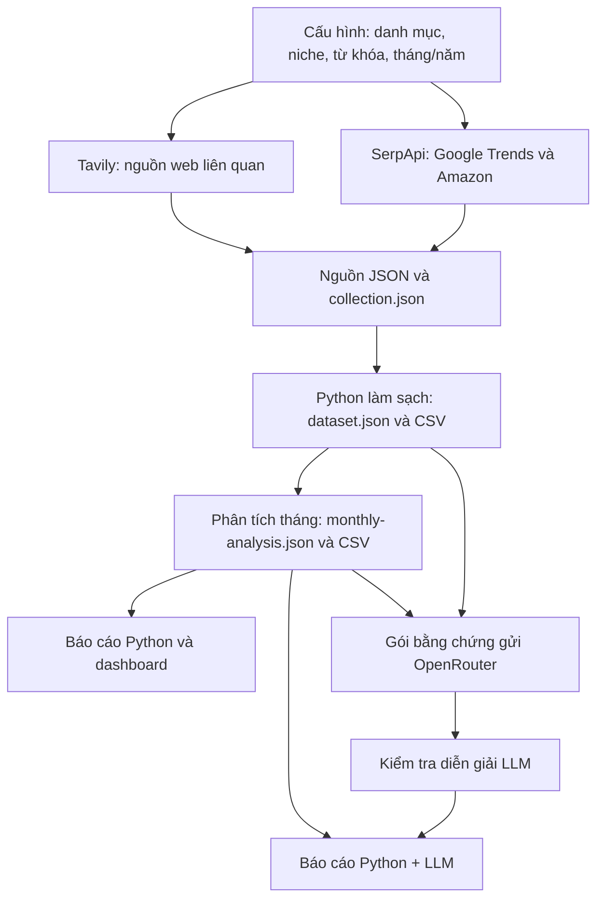

# Market Analysis

## Mục tiêu

Hỗ trợ chọn sản phẩm bán trên **Amazon Mỹ** bằng cách đối chiếu xu hướng tìm kiếm, sản phẩm đang bán và nhận xét của người mua.

**Danh mục demo: quà tặng và đồ trang trí mùa lễ hội.** Khảo sát **Q4 (tháng 10–12), các năm 2023–2026**, với ba niche:

| Niche | Nhóm sản phẩm khảo sát ban đầu |
| --- | --- |
| Quà và đồ trang trí Halloween | Boo Basket, đèn, decal, vỏ gối, bộ thủ công Halloween. |
| Trang trí bàn tiệc Thanksgiving | Khăn trải dọc bàn và phụ kiện trang trí giữa bàn. |
| Quà và đồ trang trí Noel | Advent Calendar, đồ treo cây thông, quà bỏ tất, đèn, giỏ quà Noel. |

Các nhóm và từ khóa được khai báo trước trong [config/seasonal.json](config/seasonal.json), rồi kiểm chứng bằng dữ liệu:

1. **Google Trends qua SerpApi:** đo mức quan tâm theo tháng, so lịch sử và cùng kỳ để tìm thời điểm phù hợp cho từng từ khóa.
2. **Amazon qua SerpApi:** tìm sản phẩm cùng nhóm; lấy giá, mô tả/thông số, sao, nhãn mua và review khi nguồn cung cấp. Python chọn Top 5 mỗi tháng trong mẫu.
3. **Tavily:** tìm trang bán hàng và bài viết liên quan để bổ sung thông tin, bối cảnh mùa lễ.
4. **Python + LLM qua OpenRouter:** Python tính số liệu và dựng bảng; LLM viết diễn giải có dẫn chứng. Xuất CSV, báo cáo và dashboard.

Công cụ hiện khảo sát các nhóm đã chọn, chưa tự khám phá nhóm hot mới ngoài cấu hình. Trends là chỉ số tương đối; lịch sử bốn năm là lịch sử từ khóa, còn thông tin Amazon được ghi tại ngày lấy. Tháng tương lai chưa có dữ liệu.

## Luồng dữ liệu



## Cấu trúc thư mục

| Thư mục | Mục đích |
| --- | --- |
| `market_analysis/` | Nhận lệnh terminal. |
| `market_radar/` | Gọi API, xử lý, phân tích và xuất báo cáo. `assets/` chứa giao diện; `prompts/` chứa hướng dẫn LLM. |
| `config/` | Danh mục, niche, từ khóa, tháng/năm; `presets/` có mẫu Q1–Q4. |
| `api/` | `.env` chứa key, `.env.example` là mẫu. Key không đưa lên GitHub. |
| `data/` | Nguồn JSON, CSV và kết quả từng nghiên cứu. Q4 mẫu nằm trong `seasonal-gifts-us/`. |
| `tests/` | Kiểm tra dữ liệu và chức năng chương trình. |

## Demo với dữ liệu có sẵn

Cần **Python 3.10+**, không cần cài thêm thư viện. Chạy tại thư mục dự án:

```powershell
python -m market_analysis dashboard
```

Mở **http://127.0.0.1:8765** để xem biểu đồ, lọc sản phẩm, đọc review và tải CSV. Repo đã có dữ liệu Q4; chỉ xem không cần key và không gọi API. Giữ terminal mở; `Ctrl+C` để dừng.

Trong `data/seasonal-gifts-us/`, mở `report.html` để đọc bản Python hoặc `report-combined.html` để đọc bản Python + LLM. Mỗi bản có thêm Markdown `.md`.

Xuất lại bản kết hợp từ dữ liệu và phần LLM đã lưu, không gọi API:

```powershell
python -m market_analysis report --output data/seasonal-gifts-us
```

## Đổi quý, danh mục và chạy từ đầu

Tạo `api/.env` theo [api/.env.example](api/.env.example), điền key SerpApi, Tavily và OpenRouter. Model mẫu: `recursive/flint-v1.0:free`.

Chọn mẫu trong [config/presets/](config/presets/), hoặc sao chép thành `config/my-study.json` rồi sửa:

- **Thời gian:** `months` (Q1: `[1,2,3]`, Q2: `[4,5,6]`, Q3: `[7,8,9]`, Q4: `[10,11,12]`), `years`, ngày chốt `as_of_date`.
- **Chủ đề:** `category`, `niches`, truy vấn Tavily `discovery_query`, các nhóm trong `families`: `keyword` cho Trends, `amazon_query` cho Amazon, `required_patterns` lọc tên sản phẩm.

Chỉ đổi tháng thì nhóm sản phẩm vẫn giữ nguyên. Không cần sửa Python.

**Bước 1 — gọi API, tạo dữ liệu và báo cáo Python**, ví dụ đổi sang đồ làm vườn Q2:

```powershell
python -m market_analysis seasonal --phase all --config config/presets/q2-gardening.json --output data/q2-gardening-demo --fresh
```

Lệnh gọi SerpApi/Tavily → lưu nguồn → tạo CSV → phân tích → xuất `report.html`, `report.md`, `dashboard.html` và kiểm tra dữ liệu. Chưa gọi LLM.

**Bước 2 — gọi LLM, xuất báo cáo kết hợp:**

```powershell
python -m market_analysis report --ai --output data/q2-gardening-demo --max-calls 6
```

Kết quả: `data/q2-gardening-demo/report-combined.html` và `.md`. Tải lại dashboard để chọn nghiên cứu mới. Đã có dữ liệu thì chỉ chạy bước 2; bỏ `--ai` để dùng phần LLM đã lưu còn khớp dữ liệu.

Chạy Q4 mới: dùng `config/presets/q4-gifts.json` và thư mục mới như `data/q4-new`. Hai bước phải dùng cùng `--output`.

| Tham số | Ý nghĩa |
| --- | --- |
| `--phase all` | Chạy đủ bước lấy dữ liệu, xử lý, báo cáo và kiểm tra. |
| `--config` | File cấu hình chủ đề và thời gian. |
| `--output` | Thư mục lưu/đọc dữ liệu và kết quả. |
| `--fresh` | Bỏ cache, lấy nguồn mới; cần thư mục kết quả chưa dùng. |
| `--ai` | Gọi LLM viết diễn giải mới. |
| `--max-calls 6` | Tối đa sáu lượt LLM, kể cả yêu cầu sửa lỗi. |

LLM đọc gói bằng chứng từ `dataset.json`, `monthly-analysis.json` và cấu hình trong `collection.json`. Python kiểm tra mã dẫn chứng/câu trích trước khi ghép; phần không đạt bị loại, bảng số liệu vẫn giữ. Nút AI hiện trên dashboard là nhánh thêm nhận định vào bản Python; bản kết hợp đầy đủ dùng lệnh `report --ai`.

**Chi phí:** xem mẫu không phát sinh lượt API. Lượt LLM dùng cho bản kết hợp mẫu trả phí 0 USD; thu thập mới dùng quota SerpApi/Tavily của tài khoản.

