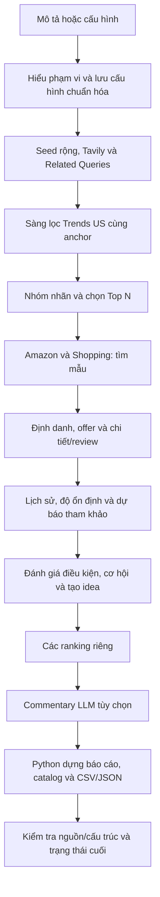

# MASTER v2 — workflow nghiên cứu cơ hội sản phẩm

Cập nhật 29/10/2026. Đã triển khai khám phá trang công khai qua Tavily, Trends tự phục hồi miễn phí → SerpApi trong trần, sàng lọc bắt buộc trước Amazon và log mở được theo từng ô tiến trình; chưa thêm Apify. Xem [đặc tả đa nguồn, ngân sách và xử lý lỗi](docs/workflow-discovery.md). Đề gốc giữ tại `TASK-1.md`; hướng dẫn chạy tại `README.md`.

## 1. Mục tiêu đã cập nhật theo trao đổi

Người dùng nhập mô tả tự nhiên bằng tiếng Việt. Hệ thống tự hiểu chủ đề chính, thị trường, khách hàng dự kiến, kỳ bán và điều kiện; tạo seed tiếng Anh, mở rộng keyword bằng nguồn thật, nhóm thành các hướng sản phẩm, tìm mẫu Amazon/Shopping, phân tích và xuất báo cáo.

Đầu vào chính không phải bộ keyword cố định. Nếu người dùng đã chọn niche thì giữ phạm vi đó. Nếu chưa chọn, AI đề xuất 3–5 niche khi phù hợp. Không yêu cầu duyệt keyword hoặc ASIN giữa workflow. Có chế độ structured nhập niche/seed khi muốn tắt AI.

Task 1 vẫn cần: một danh mục, 3–5 niche, keyword kèm bằng chứng, phân tích từng niche, 2–3 idea cụ thể/niche và ba idea nổi bật toàn báo cáo. Nếu nguồn không đủ, xuất đúng số idea có căn cứ, ghi thiếu; không bịa cho đủ.

**Python dựng báo cáo chính:** bảng, biểu đồ, nhận định từ quy tắc, idea theo mẫu nguồn, catalog, nguồn và dữ liệu. LLM free phục vụ hiểu mô tả, nhóm keyword và commentary tùy chọn. Chất lượng bố cục và số liệu không phụ thuộc việc LLM viết hết báo cáo.

## 2. Lịch sử tự chọn, kiểm chứng và dự báo

Đây là nhánh bổ sung độ vững của báo cáo, không phải điều kiện loại bỏ mọi hướng mới.

1. Chọn 2–6 năm lịch sử trước năm dự báo trên dashboard, gồm 2021/2022 (ví dụ 2021–2025), rồi lấy trong cùng một chuỗi chuẩn hóa của keyword.
2. So mức quan tâm theo năm, thời điểm cao điểm và độ biến động.
3. Kiểm chứng cuốn chiếu: dùng ít nhất hai năm trước để dự đoán năm đã biết, rồi đối chiếu thực tế và mốc cùng tháng năm trước. Báo MAE/RMSE/WAPE/sMAPE và số phép kiểm chứng; ví dụ 2021–2025 có thể kiểm chứng 2023, 2024, 2025 nếu nguồn đủ.
4. Dùng trung vị cùng tháng của các năm đủ tín hiệu để tạo forecast tham khảo 2026.
5. Đối chiếu các tháng 2026 đã quan sát đầy đủ; tháng chưa tới/thiếu không thành 0.

Năm sử dụng phải đủ 12 tháng, có tín hiệu ít nhất hai tháng và đỉnh ≥5; chuỗi native tuần/ngày cần thêm ít nhất 8 điểm nguồn dương, chuỗi native tháng dùng ngưỡng theo tháng. Ít nhất hai năm đủ tín hiệu mới dự báo. Kiểm tra độ ổn định gồm CV trung bình năm, tương quan dạng mùa và mức lặp lại cao điểm. Phương pháp/threshold được lưu trong history; đây là quy tắc minh bạch của MVP, không phải ngưỡng khoa học phổ quát. Mức bằng chứng dự báo dùng số năm kiểm chứng, độ phủ và sai số so baseline; không phải phần trăm chính xác doanh số. Xem [chi tiết kiểm chứng](docs/history-validation.md).

CV mức năm và mức lặp lại cao điểm là hai thông tin khác nhau. Dự báo không được gọi là ổn định chỉ vì năm cũ giống nhau. Nếu không tốt hơn baseline hoặc dữ liệu yếu, báo cáo phải nói rõ. Min–max lịch sử là độ phân tán, không phải khoảng tin cậy. Việc tải lại chuỗi lịch sử hôm nay không phải có snapshot quá khứ; keyword được phát hiện hiện tại không chứng minh đã khám phá cơ hội từ 2024. Amazon/Shopping hiện tại không dùng để mô phỏng doanh số cũ.

## 3. Workflow tự động và ranh giới lỗi

Sàng lọc Trends diễn ra trước tìm mẫu; lịch sử sâu theo các năm đã chọn vẫn bổ sung sau lấy mẫu và cô lập lỗi theo hướng. Nguồn thiếu không làm mất mẫu đã có. Top N mới ưu tiên phép đo trong tập ứng viên; từ bổ sung thiếu phép đo được ghi rõ. Run cũ/demo giữ cách chọn luân phiên niche. Một tiến trình Python điều phối, không cần CrewAI/n8n hoặc service riêng từng bước.

| Bước | Module | Checkpoint |
|---|---|---|
| Hiểu mô tả | workflow/understand.py | understand, normalized_config |
| Khám phá seed/web/related | workflow/broad.py | discover |
| Sàng lọc Trends | workflow/screen.py | screen |
| Chọn Top N | workflow/selection.py | select |
| Nhóm hướng | workflow/discover.py | cluster |
| Tìm mẫu | workflow/products.py | search |
| Chi tiết/review | workflow/products.py | enrich |
| Lịch sử và dự báo | workflow/history.py + forecasting/ | history và từng direction |
| Đánh giá | analysis/opportunities.py | assess |
| Idea từ bằng chứng | workflow/ideas.py | ideas |
| Xếp hạng | ranking/engine.py | rank |
| Diễn giải tùy chọn | workflow/commentary.py | commentary |
| Báo cáo và kiểm tra | reporting/ | report |

SQLite lưu trạng thái running/complete/partial/failed, bước lỗi, thời gian, request, cảnh báo và checkpoint. `manifest.json` là bản xuất tương thích. Khóa process tránh hai tiến trình cùng sửa run. Request thành công giữ raw và ngày gốc. Resume chạy lại bước thiếu/partial; khi bước trước đổi, trạng thái các bước phụ thuộc được vô hiệu hóa để không ghép kết quả cũ vào dữ liệu mới. Report-only phân tích lại quan sát đã có, không gọi API nghiên cứu.

## 4. Input thống nhất

Giao diện gọi cùng schema và pipeline với CLI. File cấu hình hỗ trợ JSON/YAML; ví dụ `configs/research.example.yaml`. Các trường chính:

- `brief`: mô tả gốc, luôn được giữ.
- `category`, `niches`: tùy chọn; niche có name và seeds khi nhập structured.
- `market=US`, `query_language=en`, `report_language=vi`: giới hạn MVP hiện tại, không tự đổi thị trường khác.
- `as_of_date`, `history_years`, `target_year`, `selling_months`: ngày chốt, 2–6 năm lịch sử tự chọn, năm dự báo và kỳ bán. `comparison_periods` chọn các khoảng tháng cùng kỳ.
- `price_range` USD, `required_features`, `excluded_features`, `preferences`, `preparation_days`: điều kiện, ưu tiên và thời gian chuẩn bị.
- `sources`, `limits`, `llm`: nguồn bật/tắt, trần request/thời gian/mẫu và AI tùy chọn.
- `mode=live|offline`: chạy nguồn thật hoặc phát lại bộ Q4 rõ nhãn.

Kế hoạch AI là giả thuyết nghiên cứu, không phải bằng chứng thị trường. Cấu hình người dùng đã nhập rõ được ưu tiên. Mỗi giả định nằm trong normalized_config và đầu báo cáo. Thiếu key/không hiểu được mô tả thì ghi lỗi có thể xử lý, không tự dùng nguyên câu tiếng Việt làm keyword tiếng Anh.

## 5. Keyword, hướng và mẫu hàng

Keyword có origin: user, llm_candidate, provider_related hoặc archive_seed. Giữ seed, loại top/rising, evidence và keyword bị loại. Không coi nhãn rising/Breakout là bằng chứng đủ để bán. Một hướng có keyword đại diện và các keyword hỗ trợ; không cộng chỉ số gần nghĩa thành tổng cầu.

Mỗi hướng có truy vấn theo keyword nguồn. Khi Amazon thực sự trả no-results cho truy vấn dài, thử một truy vấn rút gọn hữu hạn; vẫn kiểm liên quan theo hướng gốc. Lỗi quyền/quota không tạo vòng lặp truy vấn vô hạn.

Model dữ liệu phân biệt direction, keyword, product, listing, offer, occurrence, review, evidence và idea. Cùng ASIN trên amazon.com gộp danh tính, giữ các lần xuất hiện/offer. URL merchant được chuẩn hóa nhưng giữ tham số định danh như SKU. Shopping ID không thành ASIN. Sản phẩm chỉ giống tên/ảnh không tự gộp xuyên merchant. Chưa triển khai matching GTIN/model sâu; trường hợp chưa chắc được giữ riêng.

Sponsored true loại lần xuất hiện đó; lần organic khác của cùng ASIN vẫn giữ. Không có cờ giữ null. Search position không phải BSR.

Detail có nguồn giá/nhãn/ngày riêng, không kế thừa số search khi detail thiếu. Thuộc tính ghi observed/missing và evidence; không đoán từ ảnh. Rating có scope nguồn; không cộng giữa Shopping/Amazon. Review đầy đủ và excerpt riêng; excerpt cần link review; không dùng summary AI như lời khách hàng.

## 6. Đánh giá, idea và nhiều ranking

Hard filter: giá/đặc tính không đạt → excluded; chưa xác minh → pending_verification. Unknown không thành 0 hoặc negative. Review đề cập một chủ đề không tự trở thành sentiment hay tỷ lệ thị trường.

Rubric cơ hội có demand, season, purchase, differentiation và business_fit. Quy tắc positive/neutral/negative/unknown và phiên bản được lưu. Purchase chỉ dựa nhãn đúng sản phẩm. Differentiation chỉ có tín hiệu khi xuất hiện câu nguồn khớp vấn đề cụ thể. Chưa có chi phí thì không chấm lợi nhuận.

Các ranking được xuất: keyword_growth, seasonal_directions, direction_opportunity, amazon_purchase_signal, comparable_price, differentiation_candidates, evidence_strength, niche_priority, product_research_shortlist, idea_priority. Mỗi bảng có scope, eligibility, tie policy, version và unavailable reason.

Rubric có nhóm `known-abcde` theo độ đủ thông tin mùa/cầu/mua/khác biệt/phù hợp. Không so hạng giữa nhóm khác nhau. Nhãn mua so cùng loại trang/ngày. Giá chỉ xếp khi có cùng sản phẩm, variant và tiền tệ; chưa đủ thì unavailable. Không dùng ID để giả làm mức tốt hơn; ID chỉ ổn định hiển thị trong đồng hạng. Giữ toàn bộ `all_candidates` và `all_ranked_items` ngoài top K.

Idea Python bắt đầu từ mẫu có nguồn, gắn khách hàng dự kiến từ brief, mùa/tín hiệu mua và việc cần kiểm chứng. Cải tiến hướng dẫn/đóng gói/kích thước chỉ đề xuất khi có đoạn review phù hợp, trích nguyên văn. Những idea chưa đủ bằng chứng vẫn mang watchlist/pending. Đây là hệ quy tắc MVP; chiều sâu sáng tạo không tương đương nghiên cứu khách hàng trực tiếp.

## 7. Báo cáo, LLM và chi phí

Python dựng báo cáo chính HTML/Markdown/PDF theo sáu phần: (1) Mục tiêu nghiên cứu; (2) Keyword và xu hướng; (3) Kiểm chứng và dự báo; (4) Sản phẩm và bằng chứng thị trường; (5) Đề xuất nên cân nhắc bán; (6) Tổng kết ưu tiên. Có biểu đồ so cùng kỳ, bảng sai số, giá/link/ảnh mẫu nguồn và phản hồi gắn đúng sản phẩm. Báo cáo chính giữ mẫu và nhận định tiêu biểu; nguồn, bảng dài và phương pháp đầy đủ chuyển sang report-details/catalog/CSV. Hai–ba idea/niche khi đủ căn cứ; thiếu thì ghi thiếu, không nhân bản mẫu để đủ số. Xem [định dạng báo cáo](docs/report-format.md).

LLM free chỉ xử lý hiểu mô tả, nhóm từ và commentary tùy chọn. Gọi model cấu hình rồi fallback free hữu hạn, không tự dùng model trả phí. Commentary có mã nguồn thật, quote khớp review, không được đổi số/hạng. Kiểm tra ID và quote không chứng minh mọi diễn giải đúng, báo cáo ghi giới hạn này.

Mặc định trần 20 SerpApi tổng cộng, 3 Tavily, 8 LLM và 40 HTTP Trends miễn phí; 32 ứng viên, Top 10, tối đa 3 chi tiết Amazon, Shopping tắt (bật thì đối chiếu 2 keyword). Auto Trends có trần con 8 trong tổng 20 và giữ 10 lượt cho sản phẩm; Related trả phí mặc định 0. Không có phép đo hợp lệ sau các hướng khôi phục thì chờ Trends trước tìm mẫu. Resume giữ ngân sách, gồm thất bại/retry. LLM được sửa JSON một lần trong trần trước cách gom seed dự phòng. Log từng bước trong events.jsonl, xem ở từng ô UI, đã che key/reasoning. Offline không request; chi phí không biết giữ unknown.

## 8. Cấu trúc và vận hành

Code tại `src/market_research/`: providers, workflow, analysis, forecasting, ranking, reporting, llm, storage, ui. `pipeline.py` là workflow duy nhất. Cấu hình ở configs; ví dụ ở examples; kiểm thử ở tests; định nghĩa dữ liệu trong docs/data_dictionary.md.

`data/market_research.sqlite3` là database chính cho run, checkpoint, dataset, evidence, log, quota, keyword, mẫu/offer, review, chuỗi Trends và kiểm chứng. `data/runs/<run_id>/` giữ raw, bản xuất JSON và logs phục vụ kiểm tra/phục hồi. `outputs/<run_id>/` chứa report/report-details/catalog, PDF, niches, tables, sources, validation và usage. `python run.py migrate-db` nhập dữ liệu cũ còn thiếu, không xóa nguồn. Snapshot mẫu hàng nối theo danh tính nguồn/ASIN giữa các lần chạy; không giả lập giá/doanh số năm chưa có bản ghi. Xem [database](docs/database.md). Output runtime gitignored; ba mẫu báo cáo cũ được giữ riêng trong examples/reports.

Nguồn lưu `data/seasonal-gifts-us/` chỉ giữ dataset sản phẩm/review, chỉ mục Trends và raw được tham chiếu để phát lại; bộ này không có Shopping/Related Queries nên offline ghi partial. Báo cáo/CSV/dashboard/kết quả LLM cũ đã bị loại bỏ. Code cũ market_analysis, market_radar, config và các test gắn bản cũ đã được thay thế. Repo tham khảo market-research-crew, output PDF cũ và tài liệu/ảnh cũ không dùng đã được xóa. `tests/` hiện tại kiểm tra code đang dùng và được giữ để bảo trì; `.tmp-*`, cache và ảnh kiểm tra PDF tạm đã được dọn. Giữ `venv/` để dùng lại môi trường Python và `.artifact-runtime/pdf-deps/` để hỗ trợ xuất PDF. Đề gốc, tài liệu v2, báo cáo v2 và API key được giữ.

Các lệnh: `python run.py serve`, `run --brief`, `run --config`, `validate-config`, `resume --run-id`, `report --run-id`, `status --run-id`. API UI local không công khai raw hoặc .env; chỉ các file output hợp lệ được tải. Cấu hình không chấp nhận key; nguồn và traceback được che secret. Nội dung nguồn là dữ liệu, không phải chỉ dẫn.

Giao diện workspace có chọn ngân sách riêng cho SerpApi/Tavily/OpenRouter, bộ đếm đã dùng/trần, dừng có kiểm soát và resume từ checkpoint. Thanh bên có nghiên cứu mới, lịch sử, thư viện sản phẩm, báo cáo và mục đã lưu. Bảng sản phẩm hỗ trợ lọc, sắp xếp số và xuất CSV theo trạng thái bảng. Báo cáo có bản biên tập Markdown/HTML và lịch sử lưu riêng, không sửa dataset/evidence hoặc báo cáo gốc. Chi tiết cách dùng và vị trí code: [docs/workspace-ui.md](docs/workspace-ui.md).

## 9. Nghiệm thu và giới hạn đã ghi nhận

- Có kiểm thử workflow từ mô tả không có keyword tay bằng provider fixtures; lỗi nguồn/cache/ngân sách/resume; matching/Sponsored; thiếu dữ liệu; lịch tháng/holdout; dẫn chứng, HTML, CSV và HTTP.
- Ba báo cáo offline Python từ dữ liệu thật lưu trữ: Q4, lọc giá, kỳ tháng 11. Đây không phải ba lượt nghiên cứu thị trường mới.
- Live smoke phạm vi nhỏ đã có LLM, Shopping và Trends; có thể thiếu Related Queries/Amazon và gặp 429 từ model. Trạng thái partial và nguồn thiếu được giữ trong báo cáo. Không tuyên bố mọi nguồn luôn có dữ liệu.
- Chưa có triển khai scheduler/deploy, crawler mọi website, phân tích ảnh, dự báo doanh số hoặc kết luận lợi nhuận.
- Kiểm tra tự động nguồn/cấu trúc không thay thế việc đọc đối chiếu các kết luận quan trọng. Một năm holdout không chứng minh mô hình tổng quát.

Nguồn kỹ thuật: [SerpApi Trends](https://serpapi.com/google-trends-api), [Shopping](https://serpapi.com/shopping-results), [Amazon](https://serpapi.com/amazon-search-api), [OpenRouter](https://openrouter.ai/docs/guides/features/structured-outputs), [Google Trends data](https://support.google.com/trends/answer/4365533), [Forecasting principles](https://otexts.com/fpp3/toolbox.html).
