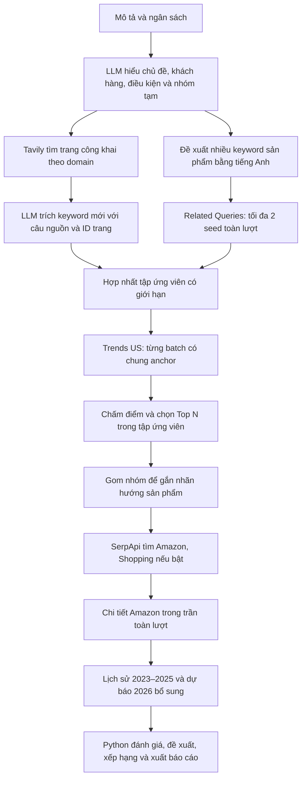

# Workflow khám phá đa nguồn — cập nhật 02/11/2026

Đã triển khai, **chưa thêm Apify**. Giữ SerpApi, Tavily và OpenRouter. Trends mặc định **auto**: thử miễn phí, lỗi/rỗng/không đủ độ phủ thì dùng SerpApi trong trần riêng và tổng trần. Mặc định `required: true`: không tự bỏ qua Trends để tìm sản phẩm chưa được đo. Bấm từng ô tiến trình để xem checkpoint và log.

Từ 02/11, khám phá giữ nguyên hình in, nghệ sĩ/nhân vật và họa tiết gắn với sản phẩm. Chế độ theo tháng vẫn chạy sàng lọc trong năm phân tích; lịch sử nhiều năm và dự báo được tách riêng. Xem [sàng lọc mẫu thiết kế theo tháng](design-trends-by-month.md).

## Chạy và nhập đầu vào

1. Dừng server đang chạy bằng **Ctrl+C**.
2. Chạy `python run.py`, mở `http://127.0.0.1:8765`, nhấn **Ctrl+F5**.
3. Nhập mô tả, chọn ngân sách, Top N, nguồn công khai rồi bấm **Bắt đầu nghiên cứu**.

Ví dụ:

> Tôi muốn tìm những loại sản phẩm được ưa chuộng làm quà tặng dịp cuối năm tại Mỹ, tháng 11–12/2026. Tìm 3 nhóm phù hợp cho người thân và bạn bè, đề xuất sản phẩm cùng mẫu tham khảo và giải thích căn cứ lựa chọn.

Hoặc sửa `configs/research.example.yaml` rồi chạy toàn bộ bằng một lệnh:

```powershell
python run.py run --config configs/research.example.yaml
```

## Luồng tự động



Thứ tự checkpoint thực tế là `understand → discover → screen → monthly → cluster → select → search → enrich → history → assess → ideas → rank → commentary → report`. Bước `cluster` tạo nhãn nhóm; bước `select` giữ từng keyword đã chọn để LLM gom nhóm không làm mất keyword thắng phép đo. `monthly` đối chiếu lịch sử ứng viên nếu bật; `history` dùng lại nguồn đã thu và bổ sung phần cần thiết cho mẫu được chọn.

Các nhóm LLM đề xuất là khung khám phá. Keyword mới từ web có thể khác seed ban đầu, nhưng phải phù hợp chủ đề và có nguyên văn trong trang nguồn. Code kiểm tra câu trích, keyword, ID trang và ID niche; từ không có trong nguồn bị loại. Việc kiểm tra nguyên văn không chứng minh nội dung trang là đúng hay toàn thị trường ưa chuộng nó.

## Các nhánh dữ liệu ngoài Amazon

Dashboard cho chọn TikTok, Facebook, Etsy, Walmart, Pinterest, eBay. Tavily thực hiện tối đa một tìm kiếm basic cho mỗi bó nguồn:

| Bó | Domain |
|---|---|
| Mạng xã hội | tiktok.com, facebook.com |
| Sàn | etsy.com, walmart.com, ebay.com |
| Hình ảnh/ý tưởng | pinterest.com |

Chỉ domain được chọn được giữ; loại kết quả ngoài domain và trang có ngày xuất bản được nhận diện nằm sau ngày chốt. Có thể không có trang của từng nền tảng; trạng thái và số trang được ghi riêng. Ngân sách Tavily tính cả retry, không hứa 3 lượt luôn phủ đủ 3 bó khi có lỗi.

Đây là **trang được công cụ tìm kiếm lập chỉ mục**, không phải toàn bộ TikTok Shop, Facebook Marketplace hay Meta Ad Library API. Không lấy tài khoản shop riêng, lượt bán, doanh thu hoặc lượt xem/like có cấu trúc. `country: united states` ưu tiên kết quả Mỹ; không xác minh quốc gia khán giả. Trang công khai được xuất thành bảng tham khảo, không tự trở thành listing Amazon có giá/sao đã xác minh.

## Sàng lọc Trends và chọn Top N

- Tập ứng viên mặc định tối đa **64** keyword. Seed được xen kẽ giữa các nhóm; keyword có dẫn chứng web/related được xen kẽ với ứng viên chưa có dẫn chứng để tránh seed chiếm hết chỗ. Các mẫu thiết kế khác nhau là ứng viên riêng dù cùng loại sản phẩm.
- Google Trends so sánh tối đa 5 từ/lần: **1 anchor cố định + tối đa 4 ứng viên**. Mặc định anchor `gift basket`; đổi bằng `trends.anchor` trong YAML nếu chủ đề khác và cần một từ mốc phù hợp hơn.
- Với `history_scope: full`, cửa sổ mặc định **90 ngày đến ngày chốt**, quốc gia **US**. Dùng các khoảng có ít nhất 21 ngày quan sát hợp lệ trong mỗi cửa sổ 28 ngày; bỏ điểm partial. Các công thức 28 ngày bên dưới thuộc nhánh này. Với `seasonal`, đo đúng `history_months` của `analysis_year`; để trống năm dùng kỳ gần nhất đã bắt đầu, xếp theo mức quan tâm trong kỳ và ghi riêng dữ liệu chưa đầy đủ.
- Mức quan tâm so sánh = trung bình 28 ngày gần nhất của keyword / trung bình anchor trong cùng batch. Anchor phải có trung bình ít nhất 1. Đây là tỷ lệ tương đối, không phải số lượt tìm kiếm.
- Tăng trưởng = `(trung bình 28 ngày gần / trung bình 28 ngày trước − 1) × 100%`. Mẫu nền bằng 0 không được biến thành mức tăng vô hạn.
- Điểm = **70% phân vị tỷ lệ quan tâm + 30% phân vị tăng trưởng** trong tập keyword đo hợp lệ. Nếu tăng trưởng không tính được, chỉ dùng phân vị quan tâm. Từ lặp ở nhiều nhóm không được tính thêm trọng số.
- Chế độ mặc định `required: true` **chỉ chọn keyword có phép đo**. Nếu Top 10 nhưng chỉ đo được 6, tìm mẫu cho 6; không điền keyword LLM vào chỗ thiếu. Nếu không đo được từ nào, chuyển **Chờ dữ liệu Trends** trước bước tìm mẫu. Các truy vấn trùng nhau chỉ tính một chỗ Top N, vẫn giữ liên hệ các nhóm. Run cũ/thiết lập chủ động `required: false` giữ lựa chọn bổ sung có nhãn chưa xác minh.

Top N là tập ưu tiên nghiên cứu trong ứng viên đã tìm được, **không phải Top toàn Google/Top bán chạy tại Mỹ**. Sampling, mức chuẩn hóa, anchor và độ phủ web đều ảnh hưởng kết quả. LLM không tự đặt điểm hay thứ hạng.

## Giới hạn và chi phí

Mặc định trong `src/market_research/config.py`, áp dụng cho lượt mới:

| Thiết lập | Mặc định | Cách sửa |
|---|---:|---|
| `limits.serpapi_requests` | 20 | Select SerpApi hoặc YAML |
| `limits.tavily_requests` | 3 | Select Tavily hoặc YAML |
| `limits.llm_requests` | 8 | Select OpenRouter hoặc YAML |
| `limits.free_trends_requests` | 40 | Trần HTTP Trends miễn phí trên dashboard/YAML |
| `limits.candidate_keywords` | 32 | Số ứng viên tối đa trên dashboard/YAML |
| `limits.top_keywords` | 10 | Top N trên dashboard/YAML |
| `limits.product_details` | 3 | Chi tiết Amazon tối đa toàn lượt |
| `limits.trends_serpapi_requests` | 8 | Trần con Trends, nằm trong tổng SerpApi |
| `limits.serpapi_product_reserve` | 10 | Giữ lượt cho tìm mẫu/chi tiết |
| `limits.trends_related_requests` | 0 | Không chi SerpApi cho related mặc định |
| `limits.shopping_keywords` | 2 | Chỉ tìm Shopping cho số keyword shortlist này |
| `trends.provider` | `auto` | Tự động miễn phí → SerpApi; có thể chọn riêng/tắt |
| `trends.required` | `true` | Chặn tìm mẫu nếu không có keyword đo hợp lệ |
| `sources.shopping` | `false` | Checkbox Shopping; bật sẽ dùng SerpApi |

Phép đo miễn phí không dùng SerpApi và thường gồm **2 HTTP**: lấy widget và lấy dữ liệu. 32 ứng viên cần khoảng 16 HTTP sàng lọc, tối đa 4 HTTP related; lịch sử 10 keyword khoảng 20 HTTP nữa. Nếu miễn phí lỗi và đang chọn auto, SerpApi so cùng batch tối đa 5 từ/lượt: khoảng 8 lượt để so 32 ứng viên + anchor, nếu mọi batch cần dự phòng. Cache/dữ liệu thiếu/retry làm số thực tế thay đổi; mọi lần gửi đều chịu trần.

Amazon Top 10 thường bắt đầu bằng khoảng **10 tìm kiếm + tối đa 3 chi tiết**. Bật Shopping mặc định chỉ thêm **2 tìm kiếm**, không thêm toàn bộ 10. Trends trả phí cũng nằm trong tổng 20: nếu dùng 8 Trends, chỉ còn 12 cho tìm mẫu/chi tiết, nên có thể thiếu một số việc. Lỗi/retry/tìm rộng cũng dùng trần này; không hứa đủ mọi nguồn khi trần thấp. Lượt đã gửi có thể bị tính quota dù dừng. Ứng dụng chưa đồng bộ quota tài khoản.

Trần Trends có hiệu lực là `min(trends_serpapi_requests, max(0, serpapi_requests − serpapi_product_reserve))`, gồm cả thất bại/retry và lịch sử. Ví dụ tổng 20, Trends 8, reserve 10: Trends tối đa 8, không phải 20+8. Tổng 6 nhưng reserve 10: Trends trả phí bằng 0; giảm reserve nếu muốn dành một phần 6 lượt để đo. Related trả phí mặc định 0 để ưu tiên sàng lọc. Select **Chỉ miễn phí** không dùng SerpApi; chọn **Tắt Trends** là chủ động nghiên cứu không đo xu hướng. Input/ngân sách của run cũ không tự thay đổi.

## Google miễn phí bị giới hạn thì sao?

Adapter gọi endpoint công khai không chính thức. Nó có thể thay đổi hoặc trả 429; **không đảm bảo có chuỗi ở mọi lần chạy**. Không chạy Chrome, không thêm Apify, không xoay proxy hoặc vượt CAPTCHA.

Kiểm tra thật trước đây ngày 28/10/2026 nhận **HTTP 429 ở explore đầu tiên**. Đợt sửa 29/10 kiểm tra fallback/JSON/log bằng fixture và HTTP local, **không dùng quota SerpApi/Tavily/OpenRouter thật**. Không cam kết Google miễn phí hoặc SerpApi sẽ có dữ liệu cho mọi keyword; không đưa fixture vào báo cáo live.

Luồng tự kiểm tra: cache hợp lệ → miễn phí → SerpApi nếu mode auto và còn phần ngân sách. HTTP 429 thật vẫn nghỉ nhánh miễn phí 15 phút giữa các lượt; không lặp Google cho mọi keyword. HTTP 200 nhưng sai tên query/rỗng/thiếu độ phủ cũng chưa được nhận là thành công. Nếu toàn bộ cửa sổ ban đầu không đo được và còn ngân sách, thử **một vòng cửa sổ 365 ngày**, cùng anchor cho các batch. Không có dữ liệu sau các hướng này thì dừng **Chờ dữ liệu Trends**, giữ checkpoint/log và không gọi Amazon.

Mở ô **Sàng lọc Trends US** để xem nguồn thử, lỗi, fallback và số lượt. Sửa key/quota/kết nối rồi bấm **Thử lại bước Trends**; bộ đếm không reset. Nếu muốn tăng trần hay đổi nguồn, bấm **Điều chỉnh ngân sách trong lượt mới**. CLI trả exit code 2 khi chờ Trends, 1 khi lỗi, 0 khi hoàn tất/partial thông thường.

## Cache, dừng và chạy tiếp

- Raw thành công trong cùng run được dùng lại khi resume.
- **Trends miễn phí và Tavily** có cache dùng chung giữa các run ở `data/cache/`, mặc định 24 giờ, theo đúng tham số. Cache giữ ngày lấy gốc, chép raw vào run mới, không tính lượt gọi mới. Đổi `trends.cache_hours: 0` để tắt cache chung cho cả hai nguồn. SerpApi/OpenRouter chỉ dùng cache trong run.
- Raw rỗng/sai/không đạt kiểm tra Trends được đánh dấu invalid và vô hiệu cache tương ứng; vẫn giữ response để kiểm tra. Resume có thể lấy lại trong trần còn lại, không mắc kẹt với HTTP 200 nhưng dữ liệu vô dụng.
- Nút dừng lưu phản hồi của yêu cầu đang gửi trước khi dừng; không gửi request hoặc retry kế tiếp. Resume không đặt lại bộ đếm và không tự đổi nguồn.
- Run cũ trước bản đa nguồn giữ luồng/thiết lập đã khóa; demo offline vẫn dùng Q4 đã lưu và không gọi mạng. Muốn dùng đầy đủ luồng mới, tạo **Nghiên cứu mới**.

## Output và nơi đọc

Trong chi tiết nghiên cứu, mở **Keyword đã sàng lọc & nguồn khám phá** để xem tỷ lệ quan tâm, tăng trưởng, điểm, trạng thái chọn, nguồn và link trang. Bộ đếm thứ tư là **Trends miễn phí · HTTP**.

**Bấm từng ô tiến trình** để mở/đóng kết quả và nhật ký riêng: “Hiểu mô tả” có niche/seed; “Khám phá từ khóa” có keyword, origin và trang nguồn; “Sàng lọc” có chỉ số, nguồn và lỗi; “Gom hướng” có kết quả LLM hoặc cách dự phòng. Các sự kiện request/cache/retry/fallback, câu trả lời JSON đã kiểm tra và một lần sửa JSON đều ghi trong `data/runs/<id>/events.jsonl`. Giao diện chỉ tải phần gần nhất, không phơi API key hoặc nội dung reasoning. Màu đi kèm nhãn chữ: hoàn tất/đang chạy/có phần thiếu/lỗi/chờ dữ liệu.

Trong `outputs/<run_id>/`:

- `report.html`, `report.md`: báo cáo Python, giải thích sàng lọc và phần thiếu.
- `catalog.html`: mẫu hàng có nguồn, giữ bộ lọc/sắp xếp/thư viện CSV đã có.
- `tables/keyword_screening.csv/.json`: tất cả ứng viên đo, chỉ số, hạng, anchor, ngày, mã bằng chứng.
- `tables/keyword_selection.csv/.json`: keyword được chọn, thứ tự tìm, lý do và phép đo nếu có.
- `tables/web_context.csv/.json`, `discovery_sources.csv/.json`: trang tham khảo và độ phủ từng nguồn.
- Các bảng sản phẩm, review, ý tưởng, lịch sử, forecast, nguồn và usage như trước.

`data/runs/<run_id>/dataset.json`, `evidence.json`, `raw/`, `checkpoints/` giữ dữ liệu/nguồn để xem lại và xử lý lỗi. Không xóa dữ liệu run của người dùng.

Khi đang **Chờ dữ liệu Trends**, chỉ có checkpoint/log và bảng keyword/screening; chưa dựng báo cáo/catalog sản phẩm. Nhánh lịch sử sâu 2023–2025 vẫn là bổ sung sau tìm mẫu; thiếu lịch sử không thay thế việc đo Trends sàng lọc hiện tại.

## Tổ chức code

| Module | Trách nhiệm |
|---|---|
| `workflow/understand.py`, `llm/prompts/understand.txt` | Hiểu brief và đề xuất seed đa dạng |
| `workflow/broad.py`, `llm/prompts/extract.txt` | Web/related độc lập; keyword mới phải có nguyên văn nguồn |
| `workflow/screen.py` | So sánh cùng anchor, độ phủ, điểm/hạng bằng Python |
| `workflow/selection.py` | Top N và lựa chọn bổ sung có nhãn |
| `providers/free_trends.py`, `trends.py` | Adapter miễn phí / SerpApi theo lựa chọn |
| `providers/client.py` | Trần, retry, cache, dừng, thời gian nghỉ 429 và raw |
| `workflow/products.py`, `history.py` | Tìm mẫu, chi tiết và lịch sử bổ sung |
| `ui/`, `reporting/` | Dashboard, bảng sàng lọc, báo cáo và CSV |

Nguồn đối chiếu kỹ thuật: [Tavily Search](https://docs.tavily.com/documentation/api-reference/endpoint/search), [Google giải thích chỉ số Trends](https://support.google.com/trends/answer/4365533), [mã nguồn tham khảo endpoint TrendsPy](https://github.com/sdil87/trendspy/blob/main/src/trendspy/client.py). Dự án không cài hay phụ thuộc TrendsPy.
